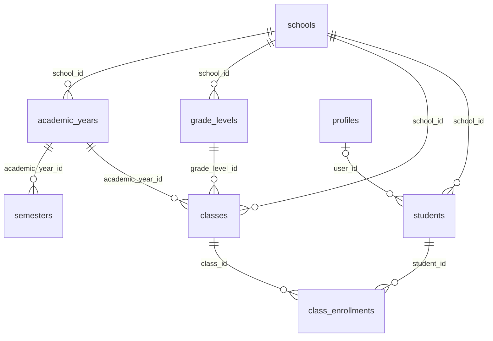

# Kế hoạch TV2 — Academic Affairs

Ngày lập: 18/11/2026. Người phụ trách: TV2. Dự án: SOMS / OJT_group5.

## 1. Hiện trạng và mục tiêu bàn giao

Cập nhật 18/11/2026 trên nhánh `hau`. Phạm vi là phần Giáo vụ của đồ án SOMS cuối kỳ.

| Hạng mục | Trạng thái đã xác nhận | Việc còn lại |
|---|---|---|
| Chạy local | Vite mở ở `localhost:5173`, ASP.NET API ở `localhost:5062` | Mỗi thành viên dùng cấu hình local của mình |
| Kết nối Supabase | API health check trả HTTP 200 với project `jaivisftvckbaxnnzhbi` | Xác minh quyền và dữ liệu mẫu của từng chức năng trên môi trường thử |
| Đăng nhập | API đăng nhập demo Giáo vụ trả HTTP 200. Dashboard vào được với vai trò `academic_affairs` | Kiểm tra quyền cụ thể và trường của tài khoản ở từng API mới |
| Giao diện | `frontend/src/App.tsx` có route `/academic/dashboard` và các thẻ giới thiệu | Thêm điều hướng và màn hình thao tác cho từng chức năng |
| API Giáo vụ | Chưa thấy controller/route `/api/academic` hoặc module Giáo vụ riêng trên `hau` | Xây luồng đọc và tạo lớp đầu tiên |
| Cấu trúc database | MCP đã đọc catalog `public`. Các bảng lõi TV2 đã có, xem mục 4 | Chưa xác minh số lượng bản ghi nghiệp vụ. Chuẩn bị tình huống danh sách trống và thiếu năm học/khối |

Mục tiêu cuối kỳ là quản lý học sinh, lớp, môn, phân công GV/GVCN, thời khóa biểu, dạy thay và lịch kiểm tra. Mỗi phần có thao tác chạy được trên UI và dữ liệu đọc/ghi qua API. Bản demo ưu tiên một kịch bản xuyên suốt với dữ liệu nhỏ, đúng quyền và xử lý được các lỗi thường gặp.

## 2. Bắt đầu ngay với Quản lý lớp học

### 2.1. Xác định dữ liệu cho luồng đầu tiên

- Dùng tài khoản Giáo vụ mẫu có sẵn. Lấy danh tính từ JWT đã xác thực và trường từ `school_memberships` còn hiệu lực. Backend dùng trường của membership hợp lệ khi chỉ có một trường. Trường hợp nhiều trường, yêu cầu chọn trường và kiểm tra membership của trường được chọn ở backend.
- Chuẩn bị ít nhất một năm học và một khối thuộc trường demo. Nếu thiếu, hiển thị rõ danh mục nào chưa có và chuẩn bị dữ liệu mẫu trên DB thử với người quản lý DB. Lớp cần `academic_year_id` và `grade_level_id` hợp lệ trước khi tạo.
- Dùng bảng `public.classes` hiện có. Map `school_id`, `academic_year_id`, `grade_level_id`, `code`, `name`, `capacity`, `status` và xác thực các tham chiếu cùng trường. GVCN có thể để trống trong luồng tạo lớp đầu tiên.

### 2.2. Chia thành hai phần có thể kiểm thử riêng

| Đầu việc | Cách thực hiện | Xong khi |
|---|---|---|
| 1. Danh sách lớp | Tạo `GET /api/academic/classes` và dữ liệu chọn năm học/khối qua các API ngữ cảnh ở mục 6. Cho lọc theo năm học. Trả mã, tên, khối, năm học, sức chứa và trạng thái. | Tài khoản Giáo vụ chỉ thấy lớp trong trường được phép, danh sách trống trả thành công. |
| 2. Màn hình lớp | Thêm lối vào **Lớp học** từ dashboard. Dùng auth/API client hiện có. Hiển thị bảng, bộ lọc, đang tải, chưa có lớp và nút thử lại khi lỗi. | Mở được từ dashboard và tải lại trang vẫn đọc từ API. |
| 3. Tạo lớp | Tạo `POST /api/academic/classes`. Form gồm mã, tên, năm học, khối và sức chứa tùy chọn. Backend xác thực mã/tên, sức chứa dương nếu có, cùng trường và unique mã theo năm học. | Lưu thành công trả 201 và lớp xuất hiện sau tải lại. Mã trùng trả 409, trường nhập sai hiển thị lỗi tương ứng. |
| 4. Thử quyền và lỗi | Thử khi chưa đăng nhập, khi thiếu quyền, khi dùng năm học/khối của trường khác, khi danh mục trống hoặc API lỗi. | Thấy trạng thái đúng trên UI và API chặn truy cập ngoài phạm vi. |

Sau khi nghiệm thu phần này, bổ sung sửa lớp và lưu trữ lớp theo trạng thái, rồi chuyển sang hồ sơ học sinh, ghi danh và chuyển lớp. Chỉ chuẩn bị bản ghi thử trên môi trường đã thống nhất với nhóm.

## 3. Kiến trúc triển khai

Luồng: React → ASP.NET controller → application service/validator → EF Core/Npgsql → Supabase PostgreSQL.

- Domain: entity và quy tắc nghiệp vụ độc lập HTTP.
- Application: DTO, interfaces, validators, AcademicService, TimetableService, ConflictCheckingService, SubstitutionService, ExamSchedulingService.
- Infrastructure: EF mappings, query/persistence, transaction, migrations, adapter đọc phòng/giáo viên/nghỉ phép và phát sự kiện.
- Api: controller, permission policy, school context, ProblemDetails, OpenAPI.
- UI: `frontend/src/features/academic/{components,pages,services,hooks,types}`; tích hợp AuthContext và cơ chế điều hướng hiện có. Nếu đổi router phải chốt với TV1 để không phá StudentRoutes.
- Unit test trong SOMS.UnitTests; thêm project integration test chạy PostgreSQL thật tách biệt và bộ UI/E2E riêng.

Không dùng dữ liệu mẫu làm fallback khi API/DB lỗi; hiển thị lỗi và cho thử lại. Tiếng Việt UTF-8 nhất quán.

## 4. Schema TV2 trên Supabase và phần cần bổ sung

### 4.1. Mapping các bảng hiện hữu

| Nhóm | Bảng và cột thực tế | Áp dụng cho TV2 |
|---|---|---|
| Trường, năm học, kỳ, khối | `schools.timezone`, `academic_years(school_id, name, start_date, end_date, status)`, `semesters(academic_year_id, ordinal, start_date, end_date, status)`, `grade_levels(school_id, grade_number)` | Kỳ lấy trường qua năm học. Mỗi trường có tối đa một năm học `active`. Khối 6–12, duy nhất theo trường. Với SOMS, cấu hình hai học kỳ theo thứ tự 1 và 2, kiểm tra cả hai nằm trong năm học và không chồng ngày. Ngày hiệu lực lấy từ cấu hình từng năm; khoảng nghỉ hè nằm sau Học kỳ II và trước Học kỳ I năm tiếp theo. |
| Học sinh | `students(school_id, user_id, student_code, full_name, date_of_birth, status, admitted_on)` | Mã duy nhất theo trường, `user_id` tùy chọn và tham chiếu `profiles.id`. Trạng thái `enrolled/transferred/graduated/withdrawn`. Chốt thao tác archive theo nghiệp vụ và CHECK hiện có. |
| Lớp và GVCN | `classes(school_id, academic_year_id, grade_level_id, code, name, homeroom_staff_id, capacity, status)` | Mã duy nhất theo năm học. `capacity` cho phép NULL, nếu có phải dương. `homeroom_staff_id → staff.id` lưu GVCN hiện tại. Lịch sử và khoảng hiệu lực cần bổ sung nếu dùng cho AA-06. |
| Ghi danh | `class_enrollments(class_id, student_id, enrolled_on, left_on, status)` | `active/moved/completed`, duy nhất theo lớp, học sinh và ngày vào. Partial unique index giới hạn một dòng `active` mỗi học sinh. Chuyển lớp trong transaction và kiểm tra các khoảng lịch sử chồng lấn. |
| Môn và phân công | `subjects(school_id, code, name, is_active)`, `teaching_assignments(class_id, subject_id, staff_id, semester_id, weekly_periods, status)` | Mã môn duy nhất theo trường. Phân công duy nhất theo bộ bốn FK, số tiết tuần dương, trạng thái `draft/active/inactive`. `weekly_periods` là tải của phân công. Chương trình lớp/kỳ và hiệu lực chi tiết cần thiết kế riêng nếu nghiệp vụ yêu cầu. |
| Giáo viên và quyền | `staff(school_id, user_id, kind, department_id, started_on, ended_on, employment_status)`, `school_memberships(school_id, user_id, role_code, status, valid_from, valid_to)` | Lọc `kind = 'teacher'` theo trường và hiệu lực nhân sự. Đối chiếu membership qua `profiles.id`, `roles`, `role_permissions` và `permissions`. Chốt nguồn chuyên môn và quy trình nghỉ GV với TV3, có thể dùng `workflow_requests` loại `teacher_leave` theo `staff_id` và khoảng ngày. |
| Phòng và tiết | `rooms(school_id, code, room_type, capacity, status)`, `period_definitions(school_id, period_no, shift, starts_at, ends_at)` | Phòng `available/maintenance/closed`, capacity có thể NULL. Tiết dùng giờ địa phương, có CHECK thứ tự giờ và unique theo trường, buổi, số tiết. Dùng `schools.timezone` (mặc định `Asia/Ho_Chi_Minh`) để suy ra thời điểm ca cụ thể. |
| Phiên bản và ô lịch | `timetable_versions(semester_id, version_no, status, created_by, published_at)`, `timetable_slots(version_id, teaching_assignment_id, room_id, weekday, period_id)` | Một slot tương ứng một tiết, `weekday` từ 1 đến 7. `room_id` bắt buộc. `version_no` duy nhất trong kỳ và kỳ có tối đa một bản `published`. Tên `entries` có thể giữ ở API và map xuống `timetable_slots`. |
| Dạy thay | `substitutions(request_id, original_slot_id, on_date, substitute_staff_id, confirmed_by, status)` | Khóa nghiệp vụ `original_slot_id + on_date`. GV gốc lấy qua slot → phân công → `staff.id`. `request_id` tùy chọn trỏ `schedule_change_requests`. |
| Kiểm tra | `exam_schedules(class_id, subject_id, semester_id, starts_at, ends_at, room_id, status)` | Một lớp mỗi dòng, phòng tùy chọn, hai mốc `timestamptz` có CHECK thứ tự, trạng thái `draft/published/cancelled`. Ca nhiều lớp hoặc giám thị cần bổ sung liên kết theo hợp đồng nhóm. `assessments/grades` phục vụ đánh giá và điểm. |
| Điểm danh, duyệt và audit | `attendance_sessions(teaching_assignment_id, slot_id, session_date, status)`, `workflow_requests`, `approval_steps`, `workflow_events`, `audit_logs` | Điểm danh `draft/finalized`, `slot_id` tùy chọn. Chốt khóa ca với TV3. Workflow chung có bước duyệt nhưng chưa có FK gắn phiên bản lịch. Audit hiện có nhận `school_id`, `actor_id`, `table_name`, `row_id`, `operation` và dữ liệu trước/sau. |

Các bảng con như `class_enrollments`, `teaching_assignments`, `timetable_slots`, `substitutions` và `exam_schedules` lấy phạm vi trường qua các FK. API cần xác thực tất cả nhánh tham chiếu về cùng trường và kỳ. Khi bổ sung constraint hoặc index, đánh giá dữ liệu cũ trên DB thử trước.

### 4.2. Ràng buộc hiện có và khoảng trống

- `timetable_slots` có unique theo phiên bản, ngày trong tuần, tiết và phòng hoặc phân công. `tr_slots_draft` kiểm tra phiên bản đích khi thêm/sửa và phiên bản cũ khi xóa. API khóa cả hai phiên bản hoặc cấm đổi `version_id` khi sửa.
- `tr_timetable_publish` chạy khi UPDATE sang `published`, kiểm tra liên kết kỳ/trường/phòng/tiết, trùng GV và lớp theo cùng `period_id`, rồi đặt `published_at`. API phải kiểm tra chồng lấn theo giờ thực, giữa các period khác ID, giữa lịch tuần, dạy thay và kiểm tra, đồng thời khóa tài nguyên lúc ghi.
- Chưa có bảng lịch theo ngày/giữ chỗ tập trung, lịch ngày nghỉ, thời gian khóa phòng, chương trình lớp/kỳ hay lịch sử GVCN chuyên biệt. Dùng slot + ngày làm khóa ca nghiệp vụ ban đầu, rồi chốt với TV3/TV5 việc suy diễn ca hoặc bổ sung dữ liệu theo ngày để giữ lịch sử và đồng bộ portal.
- Bảng TV2 trong mapping có RLS bật và FORCE RLS tắt. Policy của phiên bản, slot và lịch kiểm tra chỉ đọc dữ liệu `published` với kiểm tra trường/lớp tương ứng. Các bảng `rooms`, `staff`, `substitutions`, `schedule_change_requests`, `school_memberships` và `audit_logs` chưa có policy trong snapshot. API ASP.NET phải kiểm tra quyền và school scope theo role runtime thực tế. Kiểm thử riêng nếu dùng PostgREST.

## 5. Backlog chức năng và tiêu chí nghiệm thu

| ID | Công việc UI/API | Validation/nghiệm thu |
|---|---|---|
| AA-01 | Dashboard: sĩ số, lớp, phân công thiếu, lịch nháp/xung đột, ca cần thay | Số liệu từ DB, lọc trường/năm học/học kỳ; có loading/empty/error |
| AA-02 | Danh sách, tìm kiếm, phân trang, tạo/sửa/xem/archive học sinh | Mã không trùng; ngày sinh không tương lai; profile cùng trường; không lộ dữ liệu ngoài scope |
| AA-03 | CRUD lớp, xem sĩ số/danh sách, xếp/chuyển lớp | Kiểm tra capacity và khối; chuyển lớp trong transaction; giữ enrollment cũ và không chồng hiệu lực |
| AA-04 | CRUD môn và chương trình lớp/học kỳ | Mã chuẩn hóa không trùng; số tiết hợp lệ; không xóa môn đã có phân công/lịch |
| AA-05 | Phân công GV theo lớp/môn/học kỳ | GV active, đúng trường/chuyên môn, hiệu lực hợp lệ; cảnh báo hoặc chặn vượt định mức theo quy tắc nhóm chốt |
| AA-06 | Phân công/thay GVCN | Không có hai GVCN chính đồng thời; không mất lịch sử; chỉ sửa bằng quyền homeroom.assign |
| AA-07 | Tạo/nhân bản lịch nháp; thêm/sửa/xóa ô lịch; xem theo lớp/GV/phòng | Nhân bản tạo ID/revision mới; lưu DB; edit bằng form là bắt buộc, kéo thả là cải tiến |
| AA-08 | Kiểm tra xung đột một ô/toàn phiên bản và gợi ý ô/GV/phòng hợp lệ | Chỉ rõ loại lỗi, ngày/tiết, tài nguyên và bản ghi liên quan; không chỉ trả true/false |
| AA-09 | Gửi duyệt, duyệt/từ chối, công bố lịch | Đúng quyền/trạng thái/revision; kiểm tra lại tại commit; HS/GV chỉ thấy lịch đã công bố |
| AA-10 | Danh sách ca cần thay, tìm GV rảnh, bố trí/hủy dạy thay | GV thay đủ điều kiện; kiểm tra lịch/nghỉ phép; chỉ đổi session đích; trả lại GV gốc nếu hủy hợp lệ |
| AA-11 | CRUD lịch kiểm tra, lớp/phòng/giám thị, công bố/hủy | Chống trùng lớp/phòng/GV với cả lịch học và dạy thay; thời lượng, capacity và kỳ hợp lệ |
| AA-12 | Đồng bộ lịch thật tới portal GV/HS và lịch sử thay đổi | Sửa/công bố/dạy thay phản ánh đúng ngày; dữ liệu draft không lộ; không trả mock khi DB lỗi |

## 6. API contract dự kiến

Prefix `/api/academic`; tài nguyên luôn được lọc theo trường được server xác thực. SchoolId client truyền chỉ là yêu cầu chọn trường, không phải bằng chứng quyền. DTO ghi không cho client tự đặt actor, trạng thái duyệt hoặc SchoolId tùy ý.

| Tài nguyên | Endpoint chính | Quyền |
|---|---|---|
| Ngữ cảnh | GET /context; GET /academic-years; GET /semesters; GET /grade-levels | Quyền đọc Academic được nhóm thống nhất |
| Học sinh | GET/POST /students; GET/PUT /students/{id}; POST /students/{id}/archive | students.manage |
| Lớp/enrollment | GET/POST /classes; GET/PUT /classes/{id}; GET/POST /classes/{id}/enrollments; POST /enrollments/{id}/transfer | classes.manage; chuyển lớp yêu cầu cả quyền quản lý học sinh nếu nhóm thống nhất |
| Môn | GET/POST /subjects; GET/PUT /subjects/{id}; PUT /classes/{id}/subjects | subjects.manage |
| GV/phòng | GET /teachers; GET /rooms; GET /teachers/{id}/availability | Quyền đọc tối thiểu; dữ liệu và quyền lấy từ module sở hữu |
| Phân công | GET/POST /teaching-assignments; PUT /teaching-assignments/{id}; POST /teaching-assignments/{id}/archive | teaching_assignments.manage |
| GVCN | GET/POST /classes/{id}/homeroom-assignments | homeroom.assign |
| Lịch nháp | GET/POST /timetables; GET /timetables/{id}; POST /timetables/{id}/clone; POST/PUT/DELETE /timetables/{id}/entries[/{entryId}] | timetables.draft |
| Xung đột | POST /timetables/{id}/validate; POST /scheduling/check-conflicts; GET /scheduling/suggestions | timetables.draft hoặc scheduling.manage theo thao tác |
| Vòng đời lịch | POST /timetables/{id}/submit, /approve, /reject, /publish | Giáo vụ gửi bằng timetables.draft; BGH duyệt bằng timetables.approve và công bố bằng timetables.publish |
| Lịch công bố | GET /schedule?from=&to=&classId=&teacherId=&roomId= | Quyền xem theo vai trò và phạm vi đối tượng |
| Dạy thay | GET/POST /substitutions; POST /substitutions/{id}/cancel; GET /sessions/{id}/substitute-candidates | scheduling.manage; thêm substitutions.manage chỉ khi nhóm quyết định |
| Kiểm tra | GET/POST /exams; GET/PUT /exams/{id}; POST /exams/{id}/publish, /cancel | exams.manage |

Các permission đọc/approval phải đối chiếu DB và seed/mapping role của TV1; không tự mở endpoint cho mọi user đã login. Quyền xem portal học sinh/giáo viên tiếp tục dùng quyền hiện có và scope riêng.

Quy ước: pagination giới hạn pageSize; lọc/sort whitelist; 201 cho tạo, 400 cho input sai, 401/403 cho auth/quyền, 404 cho tài nguyên không nằm trong scope, 409 cho xung đột lịch/mã trùng/revision cũ. ProblemDetails chứa code, fieldErrors/conflicts, traceId, không trả SQL/PII. PATCH/PUT sử dụng revision hoặc If-Match; publish cần idempotency key hoặc kiểm tra trạng thái chống gửi lặp. OpenAPI có ví dụ request/response và collection demo.

## 7. Scheduling & Conflict Checking

Quy tắc cứng:
1. Một GV thực tế không dạy/coi kiểm tra hai ca chồng thời gian.
2. Một lớp không có hai hoạt động chồng thời gian, kể cả kiểm tra và dạy thay.
3. Một phòng không bị hai lịch chiếm chồng thời gian; không dùng phòng khóa/bảo trì; đủ capacity/loại phòng.
4. GV có phân công/chuyên môn hợp lệ, không nghỉ được duyệt và còn membership hiệu lực; dữ liệu cùng trường, kỳ và khoảng hiệu lực.
5. Lịch học và dạy thay nằm trong học kỳ và khung giờ hợp lệ. Các ngày nghỉ được áp dụng trước khi kiểm tra. Khoảng nghỉ hè nằm ngoài hai học kỳ, menu xem lịch vẫn xem được khoảng ngày này nhưng không sinh tiết học thường kỳ.
6. Bản nháp được kiểm tra nội bộ và với lịch đã công bố liên quan; hai bản nháp thay thế nhau không tự động chặn lẫn nhau. Phạm vi phiên bản được ghi rõ và recheck khi publish.

Quy tắc mềm: thiếu/thừa số tiết môn, tải GV, nhiều tiết liên tiếp, khoảng trống lịch. Đánh dấu warning riêng; thiếu dữ liệu bắt buộc có thể thành lỗi cứng theo chính sách chốt với nhóm.

Thuật toán: chuẩn hóa input → resolve assignment/hiệu lực/ngoại lệ → materialize các ngày cần xét → query candidate theo SchoolId và khoảng ngày → so sánh `a.Start < b.End && b.Start < a.End` cho từng tài nguyên → trả danh sách conflict có mã ổn định (TEACHER_BUSY, CLASS_BUSY, ROOM_BUSY, TEACHER_UNAVAILABLE...). Khi sửa, loại đúng bản ghi đang sửa, vẫn xét các bản ghi còn lại trong request batch. Bản kiểm tra preview không thay thế kiểm tra lúc ghi.

Chống race: kiểm tra và ghi trong transaction; khóa tài nguyên/ngày theo thứ tự cố định hoặc dùng isolation phù hợp và retry có giới hạn. Đề xuất bảng resource reservations dùng PostgreSQL exclusion constraint trên SchoolId, ResourceType, ResourceId và tstzrange cho các session đang chiếm chỗ; xác minh extension/quyền trước khi chọn. Cả học, kiểm tra và dạy thay phải đi qua cùng cơ chế đặt tài nguyên. Hai request đồng thời chỉ một request được chiếm tài nguyên; request còn lại nhận 409.

Lập lịch tối thiểu: người dùng xếp thủ công có kiểm tra và gợi ý candidate hợp lệ, không cam kết tối ưu toàn trường. Nếu bổ sung auto-generation: greedy/backtracking giới hạn thời gian, ưu tiên môn/GV/phòng bị ràng buộc nhiều; trả các tiết chưa xếp cùng lý do và vẫn validate kết quả. Không tự công bố kết quả tự sinh.

## 8. Vòng đời, dạy thay và quyền

Phiên bản lịch: `draft → pending_approval → published → archived` là các trạng thái DB dùng cho luồng đề xuất. Khi từ chối, ghi quyết định theo workflow/audit và trả phiên bản về `draft`. Kết quả duyệt cần gắn đúng phiên bản và nội dung được duyệt trước khi công bố. DB hiện có `created_by`, `version_no`, `published_at`, chưa có cột revision, người duyệt hoặc khoảng hiệu lực. Chốt cơ chế lưu quyết định/revision với TV1. Với unique một bản công bố mỗi kỳ, archive bản cũ rồi chuyển bản mới sang `published` trong cùng transaction. Muốn tra lịch lịch sử theo ngày, cần bổ sung mapping hiệu lực hoặc dữ liệu ca theo ngày.

Dạy thay: xác định ca bằng `original_slot_id + on_date`, đọc GV gốc từ phân công và kiểm tra lịch/nghỉ phép của GV thay. Dùng trạng thái `proposed/confirmed/cancelled/completed`. Khi xác nhận, kiểm tra lại xung đột và ghi audit cùng thay đổi giữ chỗ nếu có. Giữ lớp/phòng của slot nguồn. Khi hủy, kiểm tra khả năng khôi phục GV gốc và cập nhật dòng hiện có theo unique của ca. Chốt với TV3 quy tắc khóa ca đã điểm danh qua `attendance_sessions.slot_id + session_date` và cách xử lý bản ghi thiếu slot.

Quyền:
- Academic Affairs thao tác dữ liệu trường được phân công và các quyền chi tiết tương ứng.
- School Management duyệt lịch trong trường; công bố theo quyền riêng.
- Teacher chỉ đọc lịch/phân công của mình và dữ liệu lớp được giao; không sửa lịch chung.
- Student chỉ đọc dữ liệu/lịch công bố của lớp có enrollment hiệu lực tại ngày xem; Parent chỉ xem con đã liên kết hợp lệ.
- System Admin không mặc nhiên được mọi quyền nghiệp vụ trừ khi policy của TV1 quy định.

Phải kiểm tra membership active, ValidFrom/ValidTo và SchoolId tại mỗi request ghi; không chỉ dựa permission claim cũ. Frontend ẩn nút không thay thế authorization API. Xác định DB role runtime: kết nối owner/service role có thể bypass RLS, vì vậy API scope bắt buộc; nếu có truy cập PostgREST trực tiếp thì cần RLS tương ứng và kiểm thử bằng chính role/JWT đó. Không dùng khóa service role trong frontend.

## 9. UI bàn giao

Điều hướng: Tổng quan; Học sinh; Lớp học; Môn học; Phân công giảng dạy; GVCN; Thời khóa biểu; Dạy thay; Lịch kiểm tra.

Màn hình chung có bộ lọc năm học/học kỳ, tìm kiếm, phân trang, form tạo/sửa, trạng thái lưu, lỗi từng field, xác nhận thao tác ảnh hưởng lịch sử, thông báo thành công và retry. Các trang chi tiết hiển thị dữ liệu liên quan và lịch sử thay đổi cần thiết.

Timetable hiển thị lưới thứ/tiết, chọn tuần/lớp/GV/phòng, badge version/status, panel chi tiết ô, danh sách conflict có liên kết tới ô, nút lưu/gửi duyệt/công bố theo quyền. Cảnh báo khi đổi trang còn dữ liệu chưa lưu. Dạy thay và kiểm tra có calendar/list và form chọn tài nguyên chỉ hiển thị candidate phù hợp; server vẫn revalidate.

## 10. Code First với .NET 8 và EF Core 8

- Dùng solution `backend/SOMS.sln`. API và các project hiện có target `net8.0`, với EF Core và Npgsql provider `8.0.11`. Đăng ký EF mapping vào `SomsDbContext` hiện có.
- Bắt đầu từ code C#: entity, cấu hình Fluent API, truy vấn theo trường, DTO và controller. Ánh xạ đúng bảng/cột, kiểu, nullable, khóa và ràng buộc của Supabase hiện tại. Luồng đọc lớp đầu tiên dùng `classes`, `academic_years` và `grade_levels`.
- Tách việc phát triển khỏi việc chuẩn bị dữ liệu demo. Kiểm tra danh sách lớp với dữ liệu có sẵn hoặc danh sách rỗng. Đến lúc thử tạo lớp mới cần một năm học và một khối hợp lệ trong trường thử. Chuẩn bị dữ liệu giáo viên, môn, phòng và hai học kỳ khi đến chức năng tương ứng.
- Việc thêm EF mapping cho bảng có sẵn không yêu cầu áp migration lên Supabase. Khi cần đổi schema, dùng EF Core migration sau khi thiết lập baseline của schema hiện hữu và kiểm tra lịch sử migration của môi trường đích. Rà SQL sinh ra để tránh tạo lại hoặc xóa bảng hiện có, rồi thử upgrade và rollback trên PostgreSQL tách biệt.
- Chạy `dotnet build backend/SOMS.sln` và `dotnet test backend/SOMS.sln` sau mỗi đợt backend. Thử endpoint bằng tài khoản Giáo vụ demo đã có, kiểm tra quyền và phạm vi trường từ phía server.

## 11. Kế hoạch kiểm thử

| Tầng | Trường hợp bắt buộc |
|---|---|
| Unit Academic | Mã trùng/chuẩn hóa, ngày sai, capacity, chuyển lớp giữ lịch sử, hiệu lực assignment/GVCN, tài nguyên khác trường |
| Unit Scheduling | Trùng GV/lớp/phòng; khoảng tiếp giáp; nhiều tiết; khác ngày; kỳ/hiệu lực không giao nhau; ngày nghỉ; sửa loại bản thân; batch tự trùng; draft vs published |
| Unit Substitution/Exam | GV thay nghỉ/bận/sai chuyên môn; đổi/hủy đúng session; khôi phục không hợp lệ; exam vs lesson/substitution; nhiều lớp/giám thị |
| Integration PostgreSQL | Kiểm tra mapping và áp migration phần bổ sung trên DB thử khi có thay đổi schema; FK/unique/check/exclusion; rollback; optimistic concurrency; hai request đặt cùng slot; dữ liệu tồn tại sau restart |
| Integration Security | 401, thiếu quyền 403, ID khác trường, role bị thu hồi, membership hết hạn; HS/PH không đọc draft hoặc người khác; RLS nếu áp dụng |
| Integration Workflow | Chặn publish chưa duyệt/còn conflict; recheck sau khi approved; publish lặp; thay phiên bản giữ lịch sử; audit/outbox sau commit |
| UI | Form và lỗi API, lọc/phân trang, nút theo quyền, conflict panel, loading/empty/error, keyboard cơ bản |
| E2E | Dữ liệu thật từ UI → API → PostgreSQL → portal GV/HS, reload vẫn đúng; bao gồm các nhánh thất bại trong demo |

Dùng xUnit/Moq hiện có; WebApplicationFactory cho API và PostgreSQL test riêng (container nếu môi trường hỗ trợ). Không dùng EF InMemory để kết luận constraint/transaction PostgreSQL. Đề xuất Vitest/Testing Library cho UI và Playwright cho E2E sau khi kiểm tra tương thích với package hiện có. CI chạy backend build/tests, frontend typecheck/build/tests và integration/E2E ở môi trường có DB test; không kết nối DB dùng chung để reset/seed test.

## 12. Lộ trình đề xuất theo ngày làm việc

Ngày 1 là ngày bắt đầu triển khai chức năng, vì chạy local và đăng nhập đã xong. Mốc 20 ngày là ước lượng để nhóm điều chỉnh theo hạn nộp.

| Ngày | Làm gì | Nghiệm thu cuối ngày hoặc cuối đợt |
|---|---|---|
| **1** | Kiểm tra quyền và membership của tài khoản Giáo vụ đã có. Ánh xạ lớp, khối, năm học trong EF Core 8. Làm API ngữ cảnh và đọc lớp, kể cả khi dữ liệu rỗng. | GET trả danh sách thật hoặc danh sách rỗng cho trường hiện tại. |
| **2** | Thêm route/menu **Lớp học**, bảng danh sách, bộ lọc năm học và trạng thái trống/lỗi. | Vào màn hình từ dashboard, tải lại vẫn đúng dữ liệu. |
| **3–4** | Làm form tạo/sửa lớp, kiểm tra mã trùng, FK cùng trường, sức chứa và quyền. Thử lưu khi thiếu danh mục. | Tạo lớp rồi tải lại vẫn thấy. Mã trùng, khối/năm học sai trường và user thiếu quyền bị chặn. |
| **5** | Danh sách, tạo và sửa hồ sơ học sinh. Map trạng thái theo CHECK của `students`. | Tạo được học sinh trong trường demo. Mã trùng báo rõ. |
| **6** | Ghi danh và chuyển lớp trong transaction. Kiểm tra sức chứa, hiệu lực và lịch sử. | Một HS chuyển lớp, lớp cũ còn lịch sử và chỉ có một enrollment active. |
| **7** | Quản lý môn và thống nhất cách lưu chương trình lớp/kỳ nếu nhóm cần. | Có môn dùng được khi phân công, môn ngừng hoạt động được xử lý đúng. |
| **8–9** | Làm phân công GV và GVCN. Dùng staff/phòng hiện có. Thực hiện lưu lịch sử GVCN theo phương án đã chốt. | Có lớp, môn, GV và phòng sẵn sàng xếp lịch. Chặn GV sai trường hoặc không hợp lệ. |
| **10** | Tạo/nhân bản phiên bản lịch nháp và màn hình danh sách phiên bản. | Bản sao có version riêng và mở được để sửa. |
| **11** | Thêm/sửa/xóa tiết bằng form, xem theo lớp/GV/phòng. | Lưu slot thật và tải lại hiển thị đúng thứ/tiết/phòng. |
| **12–13** | Kiểm tra trùng theo giờ thực cho lớp, GV, phòng. Kiểm tra lại khi ghi và thử hai yêu cầu đồng thời. | Báo đúng tài nguyên và thời gian trùng, chỉ một yêu cầu chiếm cùng chỗ thành công. |
| **14–15** | Gửi duyệt, từ chối, công bố, thay bản công bố. Ghép API đọc lịch cho portal. | Chỉ lịch công bố xuất hiện cho người xem đúng phạm vi, việc thay phiên bản giữ được lịch sử theo quyết định của nhóm. |
| **16** | Tạo/hủy dạy thay theo slot + ngày, dùng nguồn nghỉ và kiểm tra xung đột. | Chặn GV bận/nghỉ và thấy đúng GV thay trên ngày đã chọn. |
| **17** | Tạo/công bố/hủy lịch kiểm tra, dùng chung kiểm tra trùng lịch. | Ca trùng lịch học hoặc dạy thay bị chặn. |
| **18** | Ghép portal và chạy kịch bản demo với nhóm. | Chạy từ tạo lớp đến xem lịch công bố và kiểm tra được ngày có dạy thay. |
| **19** | Sửa lỗi từ buổi ghép, thử quyền sai trường, bản ghi trống, lỗi kết nối và tải lại UI. | Có kết quả kiểm thử và danh sách lỗi còn tồn cho buổi nộp. |
| **20** | Chạy thử lần cuối, cập nhật hướng dẫn chạy và phân vai trình bày. | Thành viên khác chạy được demo với dữ liệu đã chuẩn bị. |

Các phần nên có trong bản nộp là luồng dữ liệu nền, lập/công bố lịch, kiểm tra trùng, dạy thay và lịch kiểm tra. Nếu lịch nộp gấp, ưu tiên hoàn thành luồng này bằng form cơ bản. Để kéo thả, tự xếp lịch và xuất nâng cao sau khi luồng demo chạy ổn.

### Theo dõi triển khai trên nhánh `hau`

| Mốc | Phần có mã nguồn | Còn thiếu để nghiệm thu |
|---|---|---|
| M0 | [Mapping, metadata runtime và baseline PostgreSQL](academic/M0-postgres-verification.md). Đã khôi phục schema ứng dụng 78 bảng, thử áp và hoàn tác migration. | Đã áp hai migration lên Supabase nhóm ngày 19/11/2026. [Bàn giao hosted](academic/hosted-handoff.md). |
| M1 · Ngày 1–4 | Context theo quyền và múi giờ trường, API danh mục, bảng và form lớp. Đã kiểm tra API và UI trên PostgreSQL thử. | Demo nhóm khi cần. |
| M2 · Ngày 5–7 | Hồ sơ, liên kết profile, lưu trữ, sĩ số, ghi danh/chuyển lớp và danh mục môn. Đã kiểm tra tranh chỗ cuối và rollback khi lỗi audit. | Quy ước hiệu lực ghi trong runbook. |
| M3 · Ngày 8–9 | Chương trình lớp/kỳ, phân công GV, lịch sử GVCN và tra cứu giáo viên. Đã thử API và UI. | Quy tắc chuyên môn/định mức có thể mở rộng khi có dữ liệu. |
| M4 · Ngày 10–13 | Tạo/nhân bản lịch, chỉnh ô, lọc theo lớp/GV/phòng, gợi ý tiết/phòng, phát hiện chồng giờ và tranh ghi. | Đã thử trên DB riêng. |
| M5 · Ngày 14–15 | Gửi duyệt, duyệt/từ chối và công bố theo revision; audit, hiệu lực bản cũ và API lịch theo quyền portal. | Đã thử luồng Giáo vụ, BGH và học sinh. |
| M6 · Ngày 16–17 | Dạy thay/hủy, lịch kiểm tra tạo/sửa/công bố/hủy, lịch thực tế hiển thị trên portal. | MVP một lớp mỗi ca. Giám thị và lịch ngày lễ chưa có dữ liệu. |
| M7 · Ngày 18–20 | Có kiểm thử HTTP 401, integration PostgreSQL, seed riêng và smoke Chrome xuyên suốt. [Runbook](academic/README.md) · [Bằng chứng](academic/M1-M2-verification.md). | Kiểm chứng hosted đã đạt smoke SQL và API. [Bàn giao hosted](academic/hosted-handoff.md). |

Các thao tác lớp và học sinh dùng revision PostgreSQL qua `xmin`. Cả hai nhóm API tra quyền tương ứng trực tiếp từ role và membership còn hiệu lực trước khi đọc hoặc ghi.

## 13. Kịch bản demo end-to-end

Dữ liệu seed giả, idempotent và tách môi trường: 2 trường để test scope; 1 năm học, 2 học kỳ và khoảng nghỉ hè để kiểm tra lịch trống; tối thiểu 2 lớp, 3 môn, 4 GV, 3 phòng; 10–20 HS; tài khoản Giáo vụ, người duyệt, GV, HS/PH. Không ghi mật khẩu/token vào git.

1. Đăng nhập Giáo vụ → chọn trường/năm học → tạo HS → kiểm tra mã trùng bị chặn.
2. Tạo lớp, xếp HS, chuyển một HS và chứng minh lịch sử/sĩ số đúng; lớp đầy không nhận thêm.
3. Tạo môn/chương trình, phân công GV và GVCN; thử GV không hợp lệ bị từ chối.
4. Tạo lịch nháp, thêm các ô hợp lệ; cố ý tạo trùng GV, lớp, phòng và xem từng lỗi.
5. Sửa hết lỗi → gửi duyệt → tài khoản BGH duyệt → BGH công bố. HS không xem được trước công bố, xem đúng sau công bố.
6. Bố trí GV thay cho một ngày; GV đang bận bị chặn; chọn GV rảnh thành công. Mẫu lịch tuần giữ nguyên, lịch GV/HS ngày đó đổi đúng.
7. Tạo lịch kiểm tra trùng giờ học/phòng/GV bị chặn; đổi giờ hợp lệ và công bố; portal thấy lịch mới.
8. Thử sửa URL/ID tài nguyên trường khác, user thiếu quyền và membership hết hạn đều bị chặn.
9. Reload UI/restart API chứng minh dữ liệu bền vững; xem audit. Chạy bài kiểm thử đồng thời để chứng minh không thể ghi hai ca trùng slot.

Ghi expected/actual cho từng bước, ảnh/video nếu cần, script seed và reset giới hạn môi trường demo. Không reset Supabase dùng chung.

## 14. Checklist bàn giao

- [ ] EF mapping đã được chạy thử. Nếu đổi schema, baseline, SQL migration và rollback đã được thử trên PostgreSQL tách biệt.
- [ ] AA-01 đến AA-12 có UI/API nối DB thật; đủ loading/empty/error/validation.
- [ ] Kiểm tra GV/lớp/phòng và tranh chấp đồng thời dùng chung cho lịch học, dạy thay, kiểm tra.
- [ ] Quyền chi tiết, scope trường, membership hiệu lực/thu hồi, scope GV/HS/PH đã kiểm thử.
- [ ] Lifecycle và publication đúng, không lộ draft; giữ lịch sử phiên bản và chuyển lớp.
- [ ] Backend build/tests, frontend build/UI tests, integration/E2E đạt; ghi kết quả thực tế và lỗi còn lại.
- [ ] Swagger/OpenAPI và API examples/collection hoàn chỉnh.
- [ ] README chạy local; cấu hình env mẫu không có secret; hướng dẫn migrate/seed/demo/troubleshoot.
- [ ] ERD, schema mapping, rule conflict, ma trận quyền, tài liệu API tích hợp và kịch bản demo.
- [ ] Từng PR có phạm vi rõ, migration ảnh hưởng gì và bằng chứng validation; không commit/push tự động chỉ từ kế hoạch này.

Rủi ro trọng tâm: quy tắc hiệu lực, lịch sử và chống trùng theo giờ chưa được schema hiện tại bao phủ đầy đủ; truy vấn seed/fallback ở StudentPortal có thể che lỗi tích hợp; quyền hiện tại chưa đủ school scope; hai luồng migration có thể lệch; timetable/exam/substitution dùng cơ chế giữ chỗ khác nhau dễ tạo xung đột. Kiểm tra mapping và quyền ngay ở đợt Quản lý lớp. Dùng chung cơ chế kiểm tra và giữ chỗ trước khi công bố lịch.

Tài liệu tham khảo kết nối: https://supabase.com/docs/guides/ai-tools/mcp . Kế hoạch này chưa thực thi thay đổi schema hoặc triển khai chức năng.
