# Mapping và ERD Academic Affairs

Catalog Supabase `jaivisftvckbaxnnzhbi`, PostgreSQL 17.11, ngày 18/11/2026. 32 bảng trong phạm vi TV2 và các bảng phụ thuộc trực tiếp được liệt kê bên dưới. Kiểu, nullability, giá trị mặc định, ràng buộc, index, trigger và policy lấy từ catalog.

## Quan hệ khóa ngoại

```mermaid
erDiagram
    schools ||--o{ academic_years : "school_id"
    profiles o|--o{ approval_steps : "acted_by"
    roles o|--o{ approval_steps : "assigned_role_code"
    profiles o|--o{ approval_steps : "assigned_user_id"
    workflow_requests ||--o{ approval_steps : "request_id"
    teaching_assignments ||--o{ assessments : "teaching_assignment_id"
    timetable_slots o|--o{ attendance_sessions : "slot_id"
    profiles o|--o{ attendance_sessions : "taken_by"
    teaching_assignments ||--o{ attendance_sessions : "teaching_assignment_id"
    profiles o|--o{ audit_logs : "actor_id"
    schools o|--o{ audit_logs : "school_id"
    classes ||--o{ class_enrollments : "class_id"
    students ||--o{ class_enrollments : "student_id"
    academic_years ||--o{ classes : "academic_year_id"
    grade_levels ||--o{ classes : "grade_level_id"
    staff o|--o{ classes : "homeroom_staff_id"
    schools ||--o{ classes : "school_id"
    classes ||--o{ exam_schedules : "class_id"
    rooms o|--o{ exam_schedules : "room_id"
    semesters ||--o{ exam_schedules : "semester_id"
    subjects ||--o{ exam_schedules : "subject_id"
    schools ||--o{ grade_levels : "school_id"
    assessments ||--o{ grades : "assessment_id"
    profiles o|--o{ grades : "entered_by"
    students ||--o{ grades : "student_id"
    schools ||--o{ period_definitions : "school_id"
    auth_users ||--o| profiles : "id"
    permissions ||--o{ role_permissions : "permission_code"
    roles ||--o{ role_permissions : "role_code"
    schools ||--o{ rooms : "school_id"
    profiles ||--o{ schedule_change_requests : "requester_id"
    schools ||--o{ schedule_change_requests : "school_id"
    timetable_slots o|--o{ schedule_change_requests : "slot_id"
    profiles o|--o{ school_memberships : "granted_by"
    roles ||--o{ school_memberships : "role_code"
    schools ||--o{ school_memberships : "school_id"
    profiles ||--o{ school_memberships : "user_id"
    academic_years ||--o{ semesters : "academic_year_id"
    departments o|--o{ staff : "department_id"
    schools ||--o{ staff : "school_id"
    profiles o|--o| staff : "user_id"
    schools ||--o{ students : "school_id"
    profiles o|--o| students : "user_id"
    schools ||--o{ subjects : "school_id"
    profiles o|--o{ substitutions : "confirmed_by"
    timetable_slots ||--o{ substitutions : "original_slot_id"
    schedule_change_requests o|--o{ substitutions : "request_id"
    staff ||--o{ substitutions : "substitute_staff_id"
    schools ||--o{ departments : "school_id"
    staff o|--o{ departments : "head_teacher_id"
    classes ||--o{ teaching_assignments : "class_id"
    semesters ||--o{ teaching_assignments : "semester_id"
    staff ||--o{ teaching_assignments : "staff_id"
    subjects ||--o{ teaching_assignments : "subject_id"
    period_definitions ||--o{ timetable_slots : "period_id"
    rooms ||--o{ timetable_slots : "room_id"
    teaching_assignments ||--o{ timetable_slots : "teaching_assignment_id"
    timetable_versions ||--o{ timetable_slots : "version_id"
    profiles o|--o{ timetable_versions : "created_by"
    semesters ||--o{ timetable_versions : "semester_id"
    profiles o|--o{ workflow_events : "actor_id"
    workflow_requests ||--o{ workflow_events : "request_id"
    profiles ||--o{ workflow_requests : "requester_id"
    schools ||--o{ workflow_requests : "school_id"
    staff o|--o{ workflow_requests : "staff_id"
    students o|--o{ workflow_requests : "student_id"
    schools ||--o{ guardians : "school_id"
    profiles o|--o{ guardians : "user_id"
    guardians ||--o{ student_guardians : "guardian_id"
    students ||--o{ student_guardians : "student_id"
```

## `academic_years`

RLS bật, FORCE RLS tắt.

| Cột | Kiểu | Nullable | Mặc định |
|---|---|---|---|
| `id` | `uuid` | NO | `gen_random_uuid()` |
| `school_id` | `uuid` | NO | — |
| `name` | `text` | NO | — |
| `start_date` | `date` | NO | — |
| `end_date` | `date` | NO | — |
| `status` | `text` | NO | `'planned'::text` |

- Constraint `academic_years_check` — `CHECK ((end_date > start_date))`
- Constraint `academic_years_pkey` — `PRIMARY KEY (id)`
- Constraint `academic_years_school_id_fkey` — `FOREIGN KEY (school_id) REFERENCES schools(id)`
- Constraint `academic_years_school_id_name_key` — `UNIQUE (school_id, name)`
- Constraint `academic_years_status_check` — `CHECK ((status = ANY (ARRAY['planned'::text, 'active'::text, 'closed'::text])))`
- Index `academic_years_pkey` — `CREATE UNIQUE INDEX academic_years_pkey ON public.academic_years USING btree (id)`
- Index `academic_years_school_id_name_key` — `CREATE UNIQUE INDEX academic_years_school_id_name_key ON public.academic_years USING btree (school_id, name)`
- Index `ux_active_academic_year_per_school` — `CREATE UNIQUE INDEX ux_active_academic_year_per_school ON public.academic_years USING btree (school_id) WHERE (status = 'active'::text)`
- Policy `academic_year_school_read` — `SELECT TO authenticated USING soms_private.has_role(school_id, ARRAY['system_admin'::text, 'school_management'::text, 'academic_affairs'::text, 'head_of_department'::text, 'teacher'::text, 'accountant'::text, 'facility_staff'::text, 'student'::text, 'parent'::text]) WITH CHECK —`
- Grant catalog — `authenticated` (SELECT), `postgres` (DELETE, INSERT, REFERENCES, SELECT, TRIGGER, TRUNCATE, UPDATE), `service_role` (DELETE, INSERT, REFERENCES, SELECT, TRIGGER, TRUNCATE, UPDATE).

## `approval_steps`

RLS bật, FORCE RLS tắt.

| Cột | Kiểu | Nullable | Mặc định |
|---|---|---|---|
| `id` | `uuid` | NO | `gen_random_uuid()` |
| `request_id` | `uuid` | NO | — |
| `step_no` | `integer` | NO | — |
| `assigned_role_code` | `text` | YES | — |
| `assigned_user_id` | `uuid` | YES | — |
| `status` | `text` | NO | `'pending'::text` |
| `acted_by` | `uuid` | YES | — |
| `acted_at` | `timestamp with time zone` | YES | — |
| `comment` | `text` | YES | — |

- Constraint `approval_steps_acted_by_fkey` — `FOREIGN KEY (acted_by) REFERENCES profiles(id)`
- Constraint `approval_steps_assigned_role_code_fkey` — `FOREIGN KEY (assigned_role_code) REFERENCES roles(code)`
- Constraint `approval_steps_assigned_user_id_fkey` — `FOREIGN KEY (assigned_user_id) REFERENCES profiles(id)`
- Constraint `approval_steps_check` — `CHECK (((assigned_role_code IS NOT NULL) OR (assigned_user_id IS NOT NULL)))`
- Constraint `approval_steps_pkey` — `PRIMARY KEY (id)`
- Constraint `approval_steps_request_id_fkey` — `FOREIGN KEY (request_id) REFERENCES workflow_requests(id) ON DELETE CASCADE`
- Constraint `approval_steps_request_id_step_no_key` — `UNIQUE (request_id, step_no)`
- Constraint `approval_steps_status_check` — `CHECK ((status = ANY (ARRAY['pending'::text, 'approved'::text, 'rejected'::text, 'skipped'::text])))`
- Constraint `approval_steps_step_no_check` — `CHECK ((step_no > 0))`
- Index `approval_steps_pkey` — `CREATE UNIQUE INDEX approval_steps_pkey ON public.approval_steps USING btree (id)`
- Index `approval_steps_request_id_step_no_key` — `CREATE UNIQUE INDEX approval_steps_request_id_step_no_key ON public.approval_steps USING btree (request_id, step_no)`
- Index `ix_approval_assignee` — `CREATE INDEX ix_approval_assignee ON public.approval_steps USING btree (assigned_user_id, status)`
- Policy `approval_step_read` — `SELECT TO authenticated USING ((assigned_user_id = ( SELECT auth.uid() AS uid)) OR (EXISTS ( SELECT 1 FROM workflow_requests wr WHERE ((wr.id = approval_steps.request_id) AND ((wr.requester_id = ( SELECT auth.uid() AS uid)) OR soms_private.has_role(wr.school_id, ARRAY['school_management'::text, 'academic_affairs'::text])))))) WITH CHECK —`
- Grant catalog — `authenticated` (SELECT), `postgres` (DELETE, INSERT, REFERENCES, SELECT, TRIGGER, TRUNCATE, UPDATE), `service_role` (DELETE, INSERT, REFERENCES, SELECT, TRIGGER, TRUNCATE, UPDATE).

## `assessments`

RLS bật, FORCE RLS tắt.

| Cột | Kiểu | Nullable | Mặc định |
|---|---|---|---|
| `id` | `uuid` | NO | `gen_random_uuid()` |
| `teaching_assignment_id` | `uuid` | NO | — |
| `name` | `text` | NO | — |
| `kind` | `text` | NO | — |
| `assessed_on` | `date` | YES | — |
| `max_score` | `numeric` | NO | `10` |
| `weight` | `numeric` | NO | `1` |
| `status` | `text` | NO | `'open'::text` |

- Constraint `assessments_kind_check` — `CHECK ((kind = ANY (ARRAY['regular'::text, 'midterm'::text, 'final'::text, 'other'::text])))`
- Constraint `assessments_max_score_check` — `CHECK ((max_score > (0)::numeric))`
- Constraint `assessments_pkey` — `PRIMARY KEY (id)`
- Constraint `assessments_status_check` — `CHECK ((status = ANY (ARRAY['open'::text, 'locked'::text])))`
- Constraint `assessments_teaching_assignment_id_fkey` — `FOREIGN KEY (teaching_assignment_id) REFERENCES teaching_assignments(id)`
- Constraint `assessments_weight_check` — `CHECK ((weight > (0)::numeric))`
- Index `assessments_pkey` — `CREATE UNIQUE INDEX assessments_pkey ON public.assessments USING btree (id)`
- Index `ix_assessments_assignment` — `CREATE INDEX ix_assessments_assignment ON public.assessments USING btree (teaching_assignment_id)`
- Policy `assessment_read` — `SELECT TO authenticated USING (EXISTS ( SELECT 1 FROM teaching_assignments ta WHERE ((ta.id = assessments.teaching_assignment_id) AND soms_private.can_see_class(ta.class_id)))) WITH CHECK —`
- Grant catalog — `authenticated` (SELECT), `postgres` (DELETE, INSERT, REFERENCES, SELECT, TRIGGER, TRUNCATE, UPDATE), `service_role` (DELETE, INSERT, REFERENCES, SELECT, TRIGGER, TRUNCATE, UPDATE).

## `attendance_sessions`

RLS bật, FORCE RLS tắt.

| Cột | Kiểu | Nullable | Mặc định |
|---|---|---|---|
| `id` | `uuid` | NO | `gen_random_uuid()` |
| `teaching_assignment_id` | `uuid` | NO | — |
| `slot_id` | `uuid` | YES | — |
| `session_date` | `date` | NO | — |
| `taken_by` | `uuid` | YES | — |
| `status` | `text` | NO | `'draft'::text` |
| `finalized_at` | `timestamp with time zone` | YES | — |

- Constraint `attendance_sessions_pkey` — `PRIMARY KEY (id)`
- Constraint `attendance_sessions_slot_id_fkey` — `FOREIGN KEY (slot_id) REFERENCES timetable_slots(id)`
- Constraint `attendance_sessions_status_check` — `CHECK ((status = ANY (ARRAY['draft'::text, 'finalized'::text])))`
- Constraint `attendance_sessions_taken_by_fkey` — `FOREIGN KEY (taken_by) REFERENCES profiles(id)`
- Constraint `attendance_sessions_teaching_assignment_id_fkey` — `FOREIGN KEY (teaching_assignment_id) REFERENCES teaching_assignments(id)`
- Constraint `attendance_sessions_teaching_assignment_id_session_date_slo_key` — `UNIQUE (teaching_assignment_id, session_date, slot_id)`
- Index `attendance_sessions_pkey` — `CREATE UNIQUE INDEX attendance_sessions_pkey ON public.attendance_sessions USING btree (id)`
- Index `attendance_sessions_teaching_assignment_id_session_date_slo_key` — `CREATE UNIQUE INDEX attendance_sessions_teaching_assignment_id_session_date_slo_key ON public.attendance_sessions USING btree (teaching_assignment_id, session_date, slot_id)`
- Index `ix_attendance_sessions_assignment_date` — `CREATE INDEX ix_attendance_sessions_assignment_date ON public.attendance_sessions USING btree (teaching_assignment_id, session_date)`
- Policy `attendance_session_read` — `SELECT TO authenticated USING (EXISTS ( SELECT 1 FROM teaching_assignments ta WHERE ((ta.id = attendance_sessions.teaching_assignment_id) AND (soms_private.can_see_class(ta.class_id) OR (EXISTS ( SELECT 1 FROM staff st WHERE ((st.id = ta.staff_id) AND (st.user_id = ( SELECT auth.uid() AS uid))))))))) WITH CHECK —`
- Grant catalog — `authenticated` (SELECT), `postgres` (DELETE, INSERT, REFERENCES, SELECT, TRIGGER, TRUNCATE, UPDATE), `service_role` (DELETE, INSERT, REFERENCES, SELECT, TRIGGER, TRUNCATE, UPDATE).

## `audit_logs`

RLS bật, FORCE RLS tắt.

| Cột | Kiểu | Nullable | Mặc định |
|---|---|---|---|
| `id` | `bigint` | NO | — |
| `school_id` | `uuid` | YES | — |
| `actor_id` | `uuid` | YES | — |
| `table_name` | `text` | NO | — |
| `row_id` | `text` | YES | — |
| `operation` | `text` | NO | — |
| `before_data` | `jsonb` | YES | — |
| `after_data` | `jsonb` | YES | — |
| `occurred_at` | `timestamp with time zone` | NO | `now()` |

- Constraint `audit_logs_actor_id_fkey` — `FOREIGN KEY (actor_id) REFERENCES profiles(id)`
- Constraint `audit_logs_pkey` — `PRIMARY KEY (id)`
- Constraint `audit_logs_school_id_fkey` — `FOREIGN KEY (school_id) REFERENCES schools(id)`
- Index `audit_logs_pkey` — `CREATE UNIQUE INDEX audit_logs_pkey ON public.audit_logs USING btree (id)`
- Index `ix_audit_school_time` — `CREATE INDEX ix_audit_school_time ON public.audit_logs USING btree (school_id, occurred_at DESC)`
- Grant catalog — `postgres` (DELETE, INSERT, REFERENCES, SELECT, TRIGGER, TRUNCATE, UPDATE), `service_role` (DELETE, INSERT, REFERENCES, SELECT, TRIGGER, TRUNCATE, UPDATE).

## `class_enrollments`

RLS bật, FORCE RLS tắt.

| Cột | Kiểu | Nullable | Mặc định |
|---|---|---|---|
| `id` | `uuid` | NO | `gen_random_uuid()` |
| `class_id` | `uuid` | NO | — |
| `student_id` | `uuid` | NO | — |
| `enrolled_on` | `date` | NO | `CURRENT_DATE` |
| `left_on` | `date` | YES | — |
| `status` | `text` | NO | `'active'::text` |

- Constraint `class_enrollments_check` — `CHECK (((left_on IS NULL) OR (left_on >= enrolled_on)))`
- Constraint `class_enrollments_class_id_fkey` — `FOREIGN KEY (class_id) REFERENCES classes(id)`
- Constraint `class_enrollments_class_id_student_id_enrolled_on_key` — `UNIQUE (class_id, student_id, enrolled_on)`
- Constraint `class_enrollments_pkey` — `PRIMARY KEY (id)`
- Constraint `class_enrollments_status_check` — `CHECK ((status = ANY (ARRAY['active'::text, 'moved'::text, 'completed'::text])))`
- Constraint `class_enrollments_student_id_fkey` — `FOREIGN KEY (student_id) REFERENCES students(id)`
- Index `class_enrollments_class_id_student_id_enrolled_on_key` — `CREATE UNIQUE INDEX class_enrollments_class_id_student_id_enrolled_on_key ON public.class_enrollments USING btree (class_id, student_id, enrolled_on)`
- Index `class_enrollments_pkey` — `CREATE UNIQUE INDEX class_enrollments_pkey ON public.class_enrollments USING btree (id)`
- Index `ix_class_enrollments_class` — `CREATE INDEX ix_class_enrollments_class ON public.class_enrollments USING btree (class_id, status)`
- Index `ix_class_enrollments_student` — `CREATE INDEX ix_class_enrollments_student ON public.class_enrollments USING btree (student_id, status)`
- Index `ux_student_active_enrollment` — `CREATE UNIQUE INDEX ux_student_active_enrollment ON public.class_enrollments USING btree (student_id) WHERE (status = 'active'::text)`
- Policy `class_enrollment_read` — `SELECT TO authenticated USING soms_private.can_see_student(student_id) WITH CHECK —`
- Grant catalog — `authenticated` (SELECT), `postgres` (DELETE, INSERT, REFERENCES, SELECT, TRIGGER, TRUNCATE, UPDATE), `service_role` (DELETE, INSERT, REFERENCES, SELECT, TRIGGER, TRUNCATE, UPDATE).

## `classes`

RLS bật, FORCE RLS tắt.

| Cột | Kiểu | Nullable | Mặc định |
|---|---|---|---|
| `id` | `uuid` | NO | `gen_random_uuid()` |
| `school_id` | `uuid` | NO | — |
| `academic_year_id` | `uuid` | NO | — |
| `grade_level_id` | `uuid` | NO | — |
| `code` | `text` | NO | — |
| `name` | `text` | NO | — |
| `homeroom_staff_id` | `uuid` | YES | — |
| `capacity` | `integer` | YES | — |
| `status` | `text` | NO | `'active'::text` |

- Constraint `classes_academic_year_id_code_key` — `UNIQUE (academic_year_id, code)`
- Constraint `classes_academic_year_id_fkey` — `FOREIGN KEY (academic_year_id) REFERENCES academic_years(id)`
- Constraint `classes_capacity_check` — `CHECK ((capacity > 0))`
- Constraint `classes_grade_level_id_fkey` — `FOREIGN KEY (grade_level_id) REFERENCES grade_levels(id)`
- Constraint `classes_homeroom_staff_id_fkey` — `FOREIGN KEY (homeroom_staff_id) REFERENCES staff(id)`
- Constraint `classes_pkey` — `PRIMARY KEY (id)`
- Constraint `classes_school_id_fkey` — `FOREIGN KEY (school_id) REFERENCES schools(id)`
- Constraint `classes_status_check` — `CHECK ((status = ANY (ARRAY['active'::text, 'archived'::text])))`
- Index `classes_academic_year_id_code_key` — `CREATE UNIQUE INDEX classes_academic_year_id_code_key ON public.classes USING btree (academic_year_id, code)`
- Index `classes_pkey` — `CREATE UNIQUE INDEX classes_pkey ON public.classes USING btree (id)`
- Index `ix_classes_homeroom` — `CREATE INDEX ix_classes_homeroom ON public.classes USING btree (homeroom_staff_id)`
- Index `ix_classes_school_year` — `CREATE INDEX ix_classes_school_year ON public.classes USING btree (school_id, academic_year_id)`
- Policy `class_read` — `SELECT TO authenticated USING soms_private.can_see_class(id) WITH CHECK —`
- Grant catalog — `authenticated` (SELECT), `postgres` (DELETE, INSERT, REFERENCES, SELECT, TRIGGER, TRUNCATE, UPDATE), `service_role` (DELETE, INSERT, REFERENCES, SELECT, TRIGGER, TRUNCATE, UPDATE).

## `departments`

RLS bật, FORCE RLS tắt.

| Cột | Kiểu | Nullable | Mặc định |
|---|---|---|---|
| `id` | `uuid` | NO | `gen_random_uuid()` |
| `school_id` | `uuid` | NO | — |
| `code` | `text` | NO | — |
| `name` | `text` | NO | — |
| `head_teacher_id` | `uuid` | YES | — |

- Constraint `departments_pkey` — `PRIMARY KEY (id)`
- Constraint `departments_school_id_code_key` — `UNIQUE (school_id, code)`
- Constraint `departments_school_id_fkey` — `FOREIGN KEY (school_id) REFERENCES schools(id)`
- Constraint `fk_department_head` — `FOREIGN KEY (head_teacher_id) REFERENCES staff(id)`
- Index `departments_pkey` — `CREATE UNIQUE INDEX departments_pkey ON public.departments USING btree (id)`
- Index `departments_school_id_code_key` — `CREATE UNIQUE INDEX departments_school_id_code_key ON public.departments USING btree (school_id, code)`
- Grant catalog — `postgres` (DELETE, INSERT, REFERENCES, SELECT, TRIGGER, TRUNCATE, UPDATE), `service_role` (DELETE, INSERT, REFERENCES, SELECT, TRIGGER, TRUNCATE, UPDATE).

## `exam_schedules`

RLS bật, FORCE RLS tắt.

| Cột | Kiểu | Nullable | Mặc định |
|---|---|---|---|
| `id` | `uuid` | NO | `gen_random_uuid()` |
| `class_id` | `uuid` | NO | — |
| `subject_id` | `uuid` | NO | — |
| `semester_id` | `uuid` | NO | — |
| `starts_at` | `timestamp with time zone` | NO | — |
| `ends_at` | `timestamp with time zone` | NO | — |
| `room_id` | `uuid` | YES | — |
| `status` | `text` | NO | `'draft'::text` |

- Constraint `exam_schedules_check` — `CHECK ((ends_at > starts_at))`
- Constraint `exam_schedules_class_id_fkey` — `FOREIGN KEY (class_id) REFERENCES classes(id)`
- Constraint `exam_schedules_pkey` — `PRIMARY KEY (id)`
- Constraint `exam_schedules_room_id_fkey` — `FOREIGN KEY (room_id) REFERENCES rooms(id)`
- Constraint `exam_schedules_semester_id_fkey` — `FOREIGN KEY (semester_id) REFERENCES semesters(id)`
- Constraint `exam_schedules_status_check` — `CHECK ((status = ANY (ARRAY['draft'::text, 'published'::text, 'cancelled'::text])))`
- Constraint `exam_schedules_subject_id_fkey` — `FOREIGN KEY (subject_id) REFERENCES subjects(id)`
- Index `exam_schedules_pkey` — `CREATE UNIQUE INDEX exam_schedules_pkey ON public.exam_schedules USING btree (id)`
- Policy `exam_schedule_read` — `SELECT TO authenticated USING ((status = 'published'::text) AND soms_private.can_see_class(class_id)) WITH CHECK —`
- Grant catalog — `authenticated` (SELECT), `postgres` (DELETE, INSERT, REFERENCES, SELECT, TRIGGER, TRUNCATE, UPDATE), `service_role` (DELETE, INSERT, REFERENCES, SELECT, TRIGGER, TRUNCATE, UPDATE).

## `grade_levels`

RLS bật, FORCE RLS tắt.

| Cột | Kiểu | Nullable | Mặc định |
|---|---|---|---|
| `id` | `uuid` | NO | `gen_random_uuid()` |
| `school_id` | `uuid` | NO | — |
| `grade_number` | `smallint` | NO | — |

- Constraint `grade_levels_grade_number_check` — `CHECK (((grade_number >= 6) AND (grade_number <= 12)))`
- Constraint `grade_levels_pkey` — `PRIMARY KEY (id)`
- Constraint `grade_levels_school_id_fkey` — `FOREIGN KEY (school_id) REFERENCES schools(id)`
- Constraint `grade_levels_school_id_grade_number_key` — `UNIQUE (school_id, grade_number)`
- Index `grade_levels_pkey` — `CREATE UNIQUE INDEX grade_levels_pkey ON public.grade_levels USING btree (id)`
- Index `grade_levels_school_id_grade_number_key` — `CREATE UNIQUE INDEX grade_levels_school_id_grade_number_key ON public.grade_levels USING btree (school_id, grade_number)`
- Policy `grade_level_school_read` — `SELECT TO authenticated USING soms_private.has_role(school_id, ARRAY['school_management'::text, 'academic_affairs'::text, 'head_of_department'::text, 'teacher'::text, 'student'::text, 'parent'::text]) WITH CHECK —`
- Grant catalog — `authenticated` (SELECT), `postgres` (DELETE, INSERT, REFERENCES, SELECT, TRIGGER, TRUNCATE, UPDATE), `service_role` (DELETE, INSERT, REFERENCES, SELECT, TRIGGER, TRUNCATE, UPDATE).

## `grades`

RLS bật, FORCE RLS tắt.

| Cột | Kiểu | Nullable | Mặc định |
|---|---|---|---|
| `id` | `uuid` | NO | `gen_random_uuid()` |
| `assessment_id` | `uuid` | NO | — |
| `student_id` | `uuid` | NO | — |
| `score` | `numeric` | YES | — |
| `feedback` | `text` | YES | — |
| `entered_by` | `uuid` | YES | — |
| `updated_at` | `timestamp with time zone` | NO | `now()` |

- Constraint `grades_assessment_id_fkey` — `FOREIGN KEY (assessment_id) REFERENCES assessments(id)`
- Constraint `grades_assessment_id_student_id_key` — `UNIQUE (assessment_id, student_id)`
- Constraint `grades_entered_by_fkey` — `FOREIGN KEY (entered_by) REFERENCES profiles(id)`
- Constraint `grades_pkey` — `PRIMARY KEY (id)`
- Constraint `grades_score_check` — `CHECK (((score IS NULL) OR (score >= (0)::numeric)))`
- Constraint `grades_student_id_fkey` — `FOREIGN KEY (student_id) REFERENCES students(id)`
- Index `grades_assessment_id_student_id_key` — `CREATE UNIQUE INDEX grades_assessment_id_student_id_key ON public.grades USING btree (assessment_id, student_id)`
- Index `grades_pkey` — `CREATE UNIQUE INDEX grades_pkey ON public.grades USING btree (id)`
- Index `ix_grades_student` — `CREATE INDEX ix_grades_student ON public.grades USING btree (student_id)`
- Trigger `tr_grade_validate` — `CREATE TRIGGER tr_grade_validate BEFORE INSERT OR UPDATE ON public.grades FOR EACH ROW EXECUTE FUNCTION soms_check_grade()`
- Policy `grades_read` — `SELECT TO authenticated USING soms_private.can_see_student(student_id) WITH CHECK —`
- Grant catalog — `authenticated` (SELECT), `postgres` (DELETE, INSERT, REFERENCES, SELECT, TRIGGER, TRUNCATE, UPDATE), `service_role` (DELETE, INSERT, REFERENCES, SELECT, TRIGGER, TRUNCATE, UPDATE).

## `guardians`

RLS bật, FORCE RLS tắt.

| Cột | Kiểu | Nullable | Mặc định |
|---|---|---|---|
| `id` | `uuid` | NO | `gen_random_uuid()` |
| `school_id` | `uuid` | NO | — |
| `user_id` | `uuid` | YES | — |
| `full_name` | `text` | NO | — |
| `phone` | `text` | YES | — |
| `email` | `text` | YES | — |
| `created_at` | `timestamp with time zone` | NO | `now()` |

- Constraint `guardians_pkey` — `PRIMARY KEY (id)`
- Constraint `guardians_school_id_fkey` — `FOREIGN KEY (school_id) REFERENCES schools(id)`
- Constraint `guardians_user_id_fkey` — `FOREIGN KEY (user_id) REFERENCES profiles(id)`
- Index `guardians_pkey` — `CREATE UNIQUE INDEX guardians_pkey ON public.guardians USING btree (id)`
- Index `ix_guardians_school` — `CREATE INDEX ix_guardians_school ON public.guardians USING btree (school_id)`
- Index `ix_guardians_user` — `CREATE INDEX ix_guardians_user ON public.guardians USING btree (user_id)`
- Policy `guardian_self_read` — `SELECT TO authenticated USING (user_id = ( SELECT auth.uid() AS uid)) WITH CHECK —`
- Grant catalog — `authenticated` (SELECT), `postgres` (DELETE, INSERT, REFERENCES, SELECT, TRIGGER, TRUNCATE, UPDATE), `service_role` (DELETE, INSERT, REFERENCES, SELECT, TRIGGER, TRUNCATE, UPDATE).

## `period_definitions`

RLS bật, FORCE RLS tắt.

| Cột | Kiểu | Nullable | Mặc định |
|---|---|---|---|
| `id` | `uuid` | NO | `gen_random_uuid()` |
| `school_id` | `uuid` | NO | — |
| `period_no` | `smallint` | NO | — |
| `shift` | `text` | NO | `'morning'::text` |
| `starts_at` | `time without time zone` | NO | — |
| `ends_at` | `time without time zone` | NO | — |

- Constraint `period_definitions_check` — `CHECK ((ends_at > starts_at))`
- Constraint `period_definitions_period_no_check` — `CHECK (((period_no >= 1) AND (period_no <= 20)))`
- Constraint `period_definitions_pkey` — `PRIMARY KEY (id)`
- Constraint `period_definitions_school_id_fkey` — `FOREIGN KEY (school_id) REFERENCES schools(id)`
- Constraint `period_definitions_school_id_shift_period_no_key` — `UNIQUE (school_id, shift, period_no)`
- Constraint `period_definitions_shift_check` — `CHECK ((shift = ANY (ARRAY['morning'::text, 'afternoon'::text, 'evening'::text])))`
- Index `period_definitions_pkey` — `CREATE UNIQUE INDEX period_definitions_pkey ON public.period_definitions USING btree (id)`
- Index `period_definitions_school_id_shift_period_no_key` — `CREATE UNIQUE INDEX period_definitions_school_id_shift_period_no_key ON public.period_definitions USING btree (school_id, shift, period_no)`
- Policy `period_read` — `SELECT TO authenticated USING soms_private.has_role(school_id, ARRAY['school_management'::text, 'academic_affairs'::text, 'head_of_department'::text, 'teacher'::text, 'student'::text, 'parent'::text]) WITH CHECK —`
- Grant catalog — `authenticated` (SELECT), `postgres` (DELETE, INSERT, REFERENCES, SELECT, TRIGGER, TRUNCATE, UPDATE), `service_role` (DELETE, INSERT, REFERENCES, SELECT, TRIGGER, TRUNCATE, UPDATE).

## `permissions`

RLS bật, FORCE RLS tắt.

| Cột | Kiểu | Nullable | Mặc định |
|---|---|---|---|
| `code` | `text` | NO | — |
| `description` | `text` | NO | — |

- Constraint `permissions_pkey` — `PRIMARY KEY (code)`
- Index `permissions_pkey` — `CREATE UNIQUE INDEX permissions_pkey ON public.permissions USING btree (code)`
- Grant catalog — `postgres` (DELETE, INSERT, REFERENCES, SELECT, TRIGGER, TRUNCATE, UPDATE), `service_role` (DELETE, INSERT, REFERENCES, SELECT, TRIGGER, TRUNCATE, UPDATE).

## `profiles`

RLS bật, FORCE RLS tắt.

| Cột | Kiểu | Nullable | Mặc định |
|---|---|---|---|
| `id` | `uuid` | NO | — |
| `full_name` | `text` | NO | `''::text` |
| `phone` | `text` | YES | — |
| `avatar_path` | `text` | YES | — |
| `status` | `text` | NO | `'active'::text` |
| `created_at` | `timestamp with time zone` | NO | `now()` |
| `updated_at` | `timestamp with time zone` | NO | `now()` |

- Constraint `profiles_id_fkey` — `FOREIGN KEY (id) REFERENCES auth.users(id) ON DELETE CASCADE`
- Constraint `profiles_pkey` — `PRIMARY KEY (id)`
- Constraint `profiles_status_check` — `CHECK ((status = ANY (ARRAY['active'::text, 'inactive'::text, 'suspended'::text])))`
- Index `profiles_pkey` — `CREATE UNIQUE INDEX profiles_pkey ON public.profiles USING btree (id)`
- Trigger `tr_profiles_touch` — `CREATE TRIGGER tr_profiles_touch BEFORE UPDATE ON public.profiles FOR EACH ROW EXECUTE FUNCTION soms_touch_updated_at()`
- Policy `profile_self_read` — `SELECT TO authenticated USING (id = ( SELECT auth.uid() AS uid)) WITH CHECK —`
- Grant catalog — `authenticated` (SELECT), `postgres` (DELETE, INSERT, REFERENCES, SELECT, TRIGGER, TRUNCATE, UPDATE), `service_role` (DELETE, INSERT, REFERENCES, SELECT, TRIGGER, TRUNCATE, UPDATE).

## `role_permissions`

RLS bật, FORCE RLS tắt.

| Cột | Kiểu | Nullable | Mặc định |
|---|---|---|---|
| `role_code` | `text` | NO | — |
| `permission_code` | `text` | NO | — |

- Constraint `role_permissions_permission_code_fkey` — `FOREIGN KEY (permission_code) REFERENCES permissions(code) ON DELETE CASCADE`
- Constraint `role_permissions_pkey` — `PRIMARY KEY (role_code, permission_code)`
- Constraint `role_permissions_role_code_fkey` — `FOREIGN KEY (role_code) REFERENCES roles(code) ON DELETE CASCADE`
- Index `role_permissions_pkey` — `CREATE UNIQUE INDEX role_permissions_pkey ON public.role_permissions USING btree (role_code, permission_code)`
- Grant catalog — `postgres` (DELETE, INSERT, REFERENCES, SELECT, TRIGGER, TRUNCATE, UPDATE), `service_role` (DELETE, INSERT, REFERENCES, SELECT, TRIGGER, TRUNCATE, UPDATE).

## `roles`

RLS bật, FORCE RLS tắt.

| Cột | Kiểu | Nullable | Mặc định |
|---|---|---|---|
| `code` | `text` | NO | — |
| `name_vi` | `text` | NO | — |
| `description` | `text` | YES | — |

- Constraint `roles_pkey` — `PRIMARY KEY (code)`
- Index `roles_pkey` — `CREATE UNIQUE INDEX roles_pkey ON public.roles USING btree (code)`
- Policy `roles_signed_in_read` — `SELECT TO authenticated USING true WITH CHECK —`
- Grant catalog — `authenticated` (SELECT), `postgres` (DELETE, INSERT, REFERENCES, SELECT, TRIGGER, TRUNCATE, UPDATE), `service_role` (DELETE, INSERT, REFERENCES, SELECT, TRIGGER, TRUNCATE, UPDATE).

## `rooms`

RLS bật, FORCE RLS tắt.

| Cột | Kiểu | Nullable | Mặc định |
|---|---|---|---|
| `id` | `uuid` | NO | `gen_random_uuid()` |
| `school_id` | `uuid` | NO | — |
| `code` | `text` | NO | — |
| `name` | `text` | YES | — |
| `room_type` | `text` | NO | `'classroom'::text` |
| `capacity` | `integer` | YES | — |
| `status` | `text` | NO | `'available'::text` |

- Constraint `rooms_capacity_check` — `CHECK ((capacity > 0))`
- Constraint `rooms_pkey` — `PRIMARY KEY (id)`
- Constraint `rooms_school_id_code_key` — `UNIQUE (school_id, code)`
- Constraint `rooms_school_id_fkey` — `FOREIGN KEY (school_id) REFERENCES schools(id)`
- Constraint `rooms_status_check` — `CHECK ((status = ANY (ARRAY['available'::text, 'maintenance'::text, 'closed'::text])))`
- Index `rooms_pkey` — `CREATE UNIQUE INDEX rooms_pkey ON public.rooms USING btree (id)`
- Index `rooms_school_id_code_key` — `CREATE UNIQUE INDEX rooms_school_id_code_key ON public.rooms USING btree (school_id, code)`
- Grant catalog — `postgres` (DELETE, INSERT, REFERENCES, SELECT, TRIGGER, TRUNCATE, UPDATE), `service_role` (DELETE, INSERT, REFERENCES, SELECT, TRIGGER, TRUNCATE, UPDATE).

## `schedule_change_requests`

RLS bật, FORCE RLS tắt.

| Cột | Kiểu | Nullable | Mặc định |
|---|---|---|---|
| `id` | `uuid` | NO | `gen_random_uuid()` |
| `school_id` | `uuid` | NO | — |
| `requester_id` | `uuid` | NO | — |
| `slot_id` | `uuid` | YES | — |
| `request_type` | `text` | NO | — |
| `reason` | `text` | NO | — |
| `proposed_date` | `date` | YES | — |
| `status` | `text` | NO | `'submitted'::text` |
| `created_at` | `timestamp with time zone` | NO | `now()` |

- Constraint `schedule_change_requests_pkey` — `PRIMARY KEY (id)`
- Constraint `schedule_change_requests_request_type_check` — `CHECK ((request_type = ANY (ARRAY['swap'::text, 'substitution'::text, 'cancel'::text, 'room_change'::text])))`
- Constraint `schedule_change_requests_requester_id_fkey` — `FOREIGN KEY (requester_id) REFERENCES profiles(id)`
- Constraint `schedule_change_requests_school_id_fkey` — `FOREIGN KEY (school_id) REFERENCES schools(id)`
- Constraint `schedule_change_requests_slot_id_fkey` — `FOREIGN KEY (slot_id) REFERENCES timetable_slots(id)`
- Constraint `schedule_change_requests_status_check` — `CHECK ((status = ANY (ARRAY['submitted'::text, 'reviewing'::text, 'approved'::text, 'rejected'::text, 'completed'::text, 'cancelled'::text])))`
- Index `schedule_change_requests_pkey` — `CREATE UNIQUE INDEX schedule_change_requests_pkey ON public.schedule_change_requests USING btree (id)`
- Grant catalog — `postgres` (DELETE, INSERT, REFERENCES, SELECT, TRIGGER, TRUNCATE, UPDATE), `service_role` (DELETE, INSERT, REFERENCES, SELECT, TRIGGER, TRUNCATE, UPDATE).

## `school_memberships`

RLS bật, FORCE RLS tắt.

| Cột | Kiểu | Nullable | Mặc định |
|---|---|---|---|
| `id` | `uuid` | NO | `gen_random_uuid()` |
| `school_id` | `uuid` | NO | — |
| `user_id` | `uuid` | NO | — |
| `role_code` | `text` | NO | — |
| `status` | `text` | NO | `'active'::text` |
| `granted_by` | `uuid` | YES | — |
| `valid_from` | `date` | YES | — |
| `valid_to` | `date` | YES | — |
| `created_at` | `timestamp with time zone` | NO | `now()` |

- Constraint `school_memberships_check` — `CHECK (((valid_to IS NULL) OR (valid_from IS NULL) OR (valid_to >= valid_from)))`
- Constraint `school_memberships_granted_by_fkey` — `FOREIGN KEY (granted_by) REFERENCES profiles(id)`
- Constraint `school_memberships_pkey` — `PRIMARY KEY (id)`
- Constraint `school_memberships_role_code_fkey` — `FOREIGN KEY (role_code) REFERENCES roles(code)`
- Constraint `school_memberships_school_id_fkey` — `FOREIGN KEY (school_id) REFERENCES schools(id)`
- Constraint `school_memberships_school_id_user_id_role_code_key` — `UNIQUE (school_id, user_id, role_code)`
- Constraint `school_memberships_status_check` — `CHECK ((status = ANY (ARRAY['active'::text, 'inactive'::text])))`
- Constraint `school_memberships_user_id_fkey` — `FOREIGN KEY (user_id) REFERENCES profiles(id)`
- Index `ix_school_memberships_user` — `CREATE INDEX ix_school_memberships_user ON public.school_memberships USING btree (user_id, school_id, role_code) WHERE (status = 'active'::text)`
- Index `school_memberships_pkey` — `CREATE UNIQUE INDEX school_memberships_pkey ON public.school_memberships USING btree (id)`
- Index `school_memberships_school_id_user_id_role_code_key` — `CREATE UNIQUE INDEX school_memberships_school_id_user_id_role_code_key ON public.school_memberships USING btree (school_id, user_id, role_code)`
- Grant catalog — `postgres` (DELETE, INSERT, REFERENCES, SELECT, TRIGGER, TRUNCATE, UPDATE), `service_role` (DELETE, INSERT, REFERENCES, SELECT, TRIGGER, TRUNCATE, UPDATE).

## `schools`

RLS bật, FORCE RLS tắt.

| Cột | Kiểu | Nullable | Mặc định |
|---|---|---|---|
| `id` | `uuid` | NO | `gen_random_uuid()` |
| `code` | `text` | NO | — |
| `name` | `text` | NO | — |
| `level` | `text` | NO | `'combined'::text` |
| `email` | `text` | YES | — |
| `phone` | `text` | YES | — |
| `address` | `text` | YES | — |
| `timezone` | `text` | NO | `'Asia/Ho_Chi_Minh'::text` |
| `status` | `text` | NO | `'active'::text` |
| `created_at` | `timestamp with time zone` | NO | `now()` |
| `updated_at` | `timestamp with time zone` | NO | `now()` |

- Constraint `schools_code_key` — `UNIQUE (code)`
- Constraint `schools_level_check` — `CHECK ((level = ANY (ARRAY['middle'::text, 'high'::text, 'combined'::text])))`
- Constraint `schools_pkey` — `PRIMARY KEY (id)`
- Constraint `schools_status_check` — `CHECK ((status = ANY (ARRAY['active'::text, 'inactive'::text])))`
- Index `schools_code_key` — `CREATE UNIQUE INDEX schools_code_key ON public.schools USING btree (code)`
- Index `schools_pkey` — `CREATE UNIQUE INDEX schools_pkey ON public.schools USING btree (id)`
- Trigger `tr_schools_touch` — `CREATE TRIGGER tr_schools_touch BEFORE UPDATE ON public.schools FOR EACH ROW EXECUTE FUNCTION soms_touch_updated_at()`
- Policy `school_member_read` — `SELECT TO authenticated USING soms_private.has_role(id, ARRAY['system_admin'::text, 'school_management'::text, 'academic_affairs'::text, 'head_of_department'::text, 'teacher'::text, 'accountant'::text, 'facility_staff'::text, 'student'::text, 'parent'::text]) WITH CHECK —`
- Grant catalog — `authenticated` (SELECT), `postgres` (DELETE, INSERT, REFERENCES, SELECT, TRIGGER, TRUNCATE, UPDATE), `service_role` (DELETE, INSERT, REFERENCES, SELECT, TRIGGER, TRUNCATE, UPDATE).

## `semesters`

RLS bật, FORCE RLS tắt.

| Cột | Kiểu | Nullable | Mặc định |
|---|---|---|---|
| `id` | `uuid` | NO | `gen_random_uuid()` |
| `academic_year_id` | `uuid` | NO | — |
| `name` | `text` | NO | — |
| `ordinal` | `smallint` | NO | — |
| `start_date` | `date` | NO | — |
| `end_date` | `date` | NO | — |
| `status` | `text` | NO | `'planned'::text` |

- Constraint `semesters_academic_year_id_fkey` — `FOREIGN KEY (academic_year_id) REFERENCES academic_years(id)`
- Constraint `semesters_academic_year_id_ordinal_key` — `UNIQUE (academic_year_id, ordinal)`
- Constraint `semesters_check` — `CHECK ((end_date >= start_date))`
- Constraint `semesters_ordinal_check` — `CHECK (((ordinal >= 1) AND (ordinal <= 3)))`
- Constraint `semesters_pkey` — `PRIMARY KEY (id)`
- Constraint `semesters_status_check` — `CHECK ((status = ANY (ARRAY['planned'::text, 'active'::text, 'closed'::text])))`
- Index `semesters_academic_year_id_ordinal_key` — `CREATE UNIQUE INDEX semesters_academic_year_id_ordinal_key ON public.semesters USING btree (academic_year_id, ordinal)`
- Index `semesters_pkey` — `CREATE UNIQUE INDEX semesters_pkey ON public.semesters USING btree (id)`
- Policy `semester_school_read` — `SELECT TO authenticated USING (EXISTS ( SELECT 1 FROM academic_years ay WHERE (ay.id = semesters.academic_year_id))) WITH CHECK —`
- Grant catalog — `authenticated` (SELECT), `postgres` (DELETE, INSERT, REFERENCES, SELECT, TRIGGER, TRUNCATE, UPDATE), `service_role` (DELETE, INSERT, REFERENCES, SELECT, TRIGGER, TRUNCATE, UPDATE).

## `staff`

RLS bật, FORCE RLS tắt.

| Cột | Kiểu | Nullable | Mặc định |
|---|---|---|---|
| `id` | `uuid` | NO | `gen_random_uuid()` |
| `school_id` | `uuid` | NO | — |
| `user_id` | `uuid` | YES | — |
| `employee_code` | `text` | NO | — |
| `full_name` | `text` | NO | — |
| `kind` | `text` | NO | — |
| `department_id` | `uuid` | YES | — |
| `started_on` | `date` | YES | — |
| `ended_on` | `date` | YES | — |
| `employment_status` | `text` | NO | `'active'::text` |
| `created_at` | `timestamp with time zone` | NO | `now()` |

- Constraint `staff_check` — `CHECK (((ended_on IS NULL) OR (started_on IS NULL) OR (ended_on >= started_on)))`
- Constraint `staff_department_id_fkey` — `FOREIGN KEY (department_id) REFERENCES departments(id)`
- Constraint `staff_employment_status_check` — `CHECK ((employment_status = ANY (ARRAY['active'::text, 'leave'::text, 'inactive'::text])))`
- Constraint `staff_kind_check` — `CHECK ((kind = ANY (ARRAY['teacher'::text, 'management'::text, 'academic_affairs'::text, 'accountant'::text, 'facility'::text, 'other'::text])))`
- Constraint `staff_pkey` — `PRIMARY KEY (id)`
- Constraint `staff_school_id_employee_code_key` — `UNIQUE (school_id, employee_code)`
- Constraint `staff_school_id_fkey` — `FOREIGN KEY (school_id) REFERENCES schools(id)`
- Constraint `staff_user_id_fkey` — `FOREIGN KEY (user_id) REFERENCES profiles(id)`
- Constraint `staff_user_id_key` — `UNIQUE (user_id)`
- Index `ix_staff_department` — `CREATE INDEX ix_staff_department ON public.staff USING btree (department_id)`
- Index `ix_staff_school` — `CREATE INDEX ix_staff_school ON public.staff USING btree (school_id)`
- Index `staff_pkey` — `CREATE UNIQUE INDEX staff_pkey ON public.staff USING btree (id)`
- Index `staff_school_id_employee_code_key` — `CREATE UNIQUE INDEX staff_school_id_employee_code_key ON public.staff USING btree (school_id, employee_code)`
- Index `staff_user_id_key` — `CREATE UNIQUE INDEX staff_user_id_key ON public.staff USING btree (user_id)`
- Grant catalog — `postgres` (DELETE, INSERT, REFERENCES, SELECT, TRIGGER, TRUNCATE, UPDATE), `service_role` (DELETE, INSERT, REFERENCES, SELECT, TRIGGER, TRUNCATE, UPDATE).

## `student_guardians`

RLS bật, FORCE RLS tắt.

| Cột | Kiểu | Nullable | Mặc định |
|---|---|---|---|
| `student_id` | `uuid` | NO | — |
| `guardian_id` | `uuid` | NO | — |
| `relationship` | `text` | NO | — |
| `is_primary` | `boolean` | NO | `false` |
| `can_view_academics` | `boolean` | NO | `true` |
| `can_submit_leave` | `boolean` | NO | `true` |
| `can_view_finance` | `boolean` | NO | `true` |
| `verified_at` | `timestamp with time zone` | YES | — |

- Constraint `student_guardians_guardian_id_fkey` — `FOREIGN KEY (guardian_id) REFERENCES guardians(id) ON DELETE CASCADE`
- Constraint `student_guardians_pkey` — `PRIMARY KEY (student_id, guardian_id)`
- Constraint `student_guardians_relationship_check` — `CHECK ((relationship = ANY (ARRAY['mother'::text, 'father'::text, 'guardian'::text, 'other'::text])))`
- Constraint `student_guardians_student_id_fkey` — `FOREIGN KEY (student_id) REFERENCES students(id) ON DELETE CASCADE`
- Index `ix_student_guardians_guardian` — `CREATE INDEX ix_student_guardians_guardian ON public.student_guardians USING btree (guardian_id)`
- Index `student_guardians_pkey` — `CREATE UNIQUE INDEX student_guardians_pkey ON public.student_guardians USING btree (student_id, guardian_id)`
- Index `ux_primary_guardian` — `CREATE UNIQUE INDEX ux_primary_guardian ON public.student_guardians USING btree (student_id) WHERE is_primary`
- Policy `student_guardian_self_read` — `SELECT TO authenticated USING (soms_private.is_student(student_id) OR soms_private.is_guardian(student_id, false, false)) WITH CHECK —`
- Grant catalog — `authenticated` (SELECT), `postgres` (DELETE, INSERT, REFERENCES, SELECT, TRIGGER, TRUNCATE, UPDATE), `service_role` (DELETE, INSERT, REFERENCES, SELECT, TRIGGER, TRUNCATE, UPDATE).

## `students`

RLS bật, FORCE RLS tắt.

| Cột | Kiểu | Nullable | Mặc định |
|---|---|---|---|
| `id` | `uuid` | NO | `gen_random_uuid()` |
| `school_id` | `uuid` | NO | — |
| `user_id` | `uuid` | YES | — |
| `student_code` | `text` | NO | — |
| `full_name` | `text` | NO | — |
| `date_of_birth` | `date` | YES | — |
| `status` | `text` | NO | `'enrolled'::text` |
| `admitted_on` | `date` | YES | — |
| `created_at` | `timestamp with time zone` | NO | `now()` |

- Constraint `students_pkey` — `PRIMARY KEY (id)`
- Constraint `students_school_id_fkey` — `FOREIGN KEY (school_id) REFERENCES schools(id)`
- Constraint `students_school_id_student_code_key` — `UNIQUE (school_id, student_code)`
- Constraint `students_status_check` — `CHECK ((status = ANY (ARRAY['enrolled'::text, 'transferred'::text, 'graduated'::text, 'withdrawn'::text])))`
- Constraint `students_user_id_fkey` — `FOREIGN KEY (user_id) REFERENCES profiles(id)`
- Constraint `students_user_id_key` — `UNIQUE (user_id)`
- Index `ix_students_school` — `CREATE INDEX ix_students_school ON public.students USING btree (school_id)`
- Index `students_pkey` — `CREATE UNIQUE INDEX students_pkey ON public.students USING btree (id)`
- Index `students_school_id_student_code_key` — `CREATE UNIQUE INDEX students_school_id_student_code_key ON public.students USING btree (school_id, student_code)`
- Index `students_user_id_key` — `CREATE UNIQUE INDEX students_user_id_key ON public.students USING btree (user_id)`
- Policy `student_read` — `SELECT TO authenticated USING soms_private.can_see_student(id) WITH CHECK —`
- Grant catalog — `authenticated` (SELECT), `postgres` (DELETE, INSERT, REFERENCES, SELECT, TRIGGER, TRUNCATE, UPDATE), `service_role` (DELETE, INSERT, REFERENCES, SELECT, TRIGGER, TRUNCATE, UPDATE).

## `subjects`

RLS bật, FORCE RLS tắt.

| Cột | Kiểu | Nullable | Mặc định |
|---|---|---|---|
| `id` | `uuid` | NO | `gen_random_uuid()` |
| `school_id` | `uuid` | NO | — |
| `code` | `text` | NO | — |
| `name` | `text` | NO | — |
| `is_active` | `boolean` | NO | `true` |

- Constraint `subjects_pkey` — `PRIMARY KEY (id)`
- Constraint `subjects_school_id_code_key` — `UNIQUE (school_id, code)`
- Constraint `subjects_school_id_fkey` — `FOREIGN KEY (school_id) REFERENCES schools(id)`
- Index `subjects_pkey` — `CREATE UNIQUE INDEX subjects_pkey ON public.subjects USING btree (id)`
- Index `subjects_school_id_code_key` — `CREATE UNIQUE INDEX subjects_school_id_code_key ON public.subjects USING btree (school_id, code)`
- Policy `subject_school_read` — `SELECT TO authenticated USING soms_private.has_role(school_id, ARRAY['school_management'::text, 'academic_affairs'::text, 'head_of_department'::text, 'teacher'::text, 'student'::text, 'parent'::text]) WITH CHECK —`
- Grant catalog — `authenticated` (SELECT), `postgres` (DELETE, INSERT, REFERENCES, SELECT, TRIGGER, TRUNCATE, UPDATE), `service_role` (DELETE, INSERT, REFERENCES, SELECT, TRIGGER, TRUNCATE, UPDATE).

## `substitutions`

RLS bật, FORCE RLS tắt.

| Cột | Kiểu | Nullable | Mặc định |
|---|---|---|---|
| `id` | `uuid` | NO | `gen_random_uuid()` |
| `request_id` | `uuid` | YES | — |
| `original_slot_id` | `uuid` | NO | — |
| `on_date` | `date` | NO | — |
| `substitute_staff_id` | `uuid` | NO | — |
| `confirmed_by` | `uuid` | YES | — |
| `status` | `text` | NO | `'proposed'::text` |

- Constraint `substitutions_confirmed_by_fkey` — `FOREIGN KEY (confirmed_by) REFERENCES profiles(id)`
- Constraint `substitutions_original_slot_id_fkey` — `FOREIGN KEY (original_slot_id) REFERENCES timetable_slots(id)`
- Constraint `substitutions_original_slot_id_on_date_key` — `UNIQUE (original_slot_id, on_date)`
- Constraint `substitutions_pkey` — `PRIMARY KEY (id)`
- Constraint `substitutions_request_id_fkey` — `FOREIGN KEY (request_id) REFERENCES schedule_change_requests(id)`
- Constraint `substitutions_status_check` — `CHECK ((status = ANY (ARRAY['proposed'::text, 'confirmed'::text, 'cancelled'::text, 'completed'::text])))`
- Constraint `substitutions_substitute_staff_id_fkey` — `FOREIGN KEY (substitute_staff_id) REFERENCES staff(id)`
- Index `substitutions_original_slot_id_on_date_key` — `CREATE UNIQUE INDEX substitutions_original_slot_id_on_date_key ON public.substitutions USING btree (original_slot_id, on_date)`
- Index `substitutions_pkey` — `CREATE UNIQUE INDEX substitutions_pkey ON public.substitutions USING btree (id)`
- Grant catalog — `postgres` (DELETE, INSERT, REFERENCES, SELECT, TRIGGER, TRUNCATE, UPDATE), `service_role` (DELETE, INSERT, REFERENCES, SELECT, TRIGGER, TRUNCATE, UPDATE).

## `teaching_assignments`

RLS bật, FORCE RLS tắt.

| Cột | Kiểu | Nullable | Mặc định |
|---|---|---|---|
| `id` | `uuid` | NO | `gen_random_uuid()` |
| `class_id` | `uuid` | NO | — |
| `subject_id` | `uuid` | NO | — |
| `staff_id` | `uuid` | NO | — |
| `semester_id` | `uuid` | NO | — |
| `weekly_periods` | `smallint` | NO | — |
| `status` | `text` | NO | `'active'::text` |

- Constraint `teaching_assignments_class_id_fkey` — `FOREIGN KEY (class_id) REFERENCES classes(id)`
- Constraint `teaching_assignments_class_id_subject_id_semester_id_staff__key` — `UNIQUE (class_id, subject_id, semester_id, staff_id)`
- Constraint `teaching_assignments_pkey` — `PRIMARY KEY (id)`
- Constraint `teaching_assignments_semester_id_fkey` — `FOREIGN KEY (semester_id) REFERENCES semesters(id)`
- Constraint `teaching_assignments_staff_id_fkey` — `FOREIGN KEY (staff_id) REFERENCES staff(id)`
- Constraint `teaching_assignments_status_check` — `CHECK ((status = ANY (ARRAY['draft'::text, 'active'::text, 'inactive'::text])))`
- Constraint `teaching_assignments_subject_id_fkey` — `FOREIGN KEY (subject_id) REFERENCES subjects(id)`
- Constraint `teaching_assignments_weekly_periods_check` — `CHECK ((weekly_periods > 0))`
- Index `ix_teaching_class_semester` — `CREATE INDEX ix_teaching_class_semester ON public.teaching_assignments USING btree (class_id, semester_id)`
- Index `ix_teaching_staff_semester` — `CREATE INDEX ix_teaching_staff_semester ON public.teaching_assignments USING btree (staff_id, semester_id)`
- Index `teaching_assignments_class_id_subject_id_semester_id_staff__key` — `CREATE UNIQUE INDEX teaching_assignments_class_id_subject_id_semester_id_staff__key ON public.teaching_assignments USING btree (class_id, subject_id, semester_id, staff_id)`
- Index `teaching_assignments_pkey` — `CREATE UNIQUE INDEX teaching_assignments_pkey ON public.teaching_assignments USING btree (id)`
- Policy `assignment_read` — `SELECT TO authenticated USING soms_private.can_see_class(class_id) WITH CHECK —`
- Grant catalog — `authenticated` (SELECT), `postgres` (DELETE, INSERT, REFERENCES, SELECT, TRIGGER, TRUNCATE, UPDATE), `service_role` (DELETE, INSERT, REFERENCES, SELECT, TRIGGER, TRUNCATE, UPDATE).

## `timetable_slots`

RLS bật, FORCE RLS tắt.

| Cột | Kiểu | Nullable | Mặc định |
|---|---|---|---|
| `id` | `uuid` | NO | `gen_random_uuid()` |
| `version_id` | `uuid` | NO | — |
| `teaching_assignment_id` | `uuid` | NO | — |
| `room_id` | `uuid` | NO | — |
| `weekday` | `smallint` | NO | — |
| `period_id` | `uuid` | NO | — |
| `created_at` | `timestamp with time zone` | NO | `now()` |

- Constraint `timetable_slots_period_id_fkey` — `FOREIGN KEY (period_id) REFERENCES period_definitions(id)`
- Constraint `timetable_slots_pkey` — `PRIMARY KEY (id)`
- Constraint `timetable_slots_room_id_fkey` — `FOREIGN KEY (room_id) REFERENCES rooms(id)`
- Constraint `timetable_slots_teaching_assignment_id_fkey` — `FOREIGN KEY (teaching_assignment_id) REFERENCES teaching_assignments(id)`
- Constraint `timetable_slots_version_id_fkey` — `FOREIGN KEY (version_id) REFERENCES timetable_versions(id) ON DELETE CASCADE`
- Constraint `timetable_slots_version_id_room_id_weekday_period_id_key` — `UNIQUE (version_id, room_id, weekday, period_id)`
- Constraint `timetable_slots_version_id_teaching_assignment_id_weekday_p_key` — `UNIQUE (version_id, teaching_assignment_id, weekday, period_id)`
- Constraint `timetable_slots_weekday_check` — `CHECK (((weekday >= 1) AND (weekday <= 7)))`
- Index `ix_timetable_slots_assignment` — `CREATE INDEX ix_timetable_slots_assignment ON public.timetable_slots USING btree (teaching_assignment_id)`
- Index `ix_timetable_slots_version_day` — `CREATE INDEX ix_timetable_slots_version_day ON public.timetable_slots USING btree (version_id, weekday)`
- Index `timetable_slots_pkey` — `CREATE UNIQUE INDEX timetable_slots_pkey ON public.timetable_slots USING btree (id)`
- Index `timetable_slots_version_id_room_id_weekday_period_id_key` — `CREATE UNIQUE INDEX timetable_slots_version_id_room_id_weekday_period_id_key ON public.timetable_slots USING btree (version_id, room_id, weekday, period_id)`
- Index `timetable_slots_version_id_teaching_assignment_id_weekday_p_key` — `CREATE UNIQUE INDEX timetable_slots_version_id_teaching_assignment_id_weekday_p_key ON public.timetable_slots USING btree (version_id, teaching_assignment_id, weekday, period_id)`
- Trigger `tr_slots_draft` — `CREATE TRIGGER tr_slots_draft BEFORE INSERT OR DELETE OR UPDATE ON public.timetable_slots FOR EACH ROW EXECUTE FUNCTION soms_require_draft_timetable()`
- Policy `timetable_slot_read` — `SELECT TO authenticated USING ((EXISTS ( SELECT 1 FROM timetable_versions tv WHERE ((tv.id = timetable_slots.version_id) AND (tv.status = 'published'::text)))) AND (EXISTS ( SELECT 1 FROM teaching_assignments a WHERE ((a.id = timetable_slots.teaching_assignment_id) AND soms_private.can_see_class(a.class_id))))) WITH CHECK —`
- Grant catalog — `authenticated` (SELECT), `postgres` (DELETE, INSERT, REFERENCES, SELECT, TRIGGER, TRUNCATE, UPDATE), `service_role` (DELETE, INSERT, REFERENCES, SELECT, TRIGGER, TRUNCATE, UPDATE).

## `timetable_versions`

RLS bật, FORCE RLS tắt.

| Cột | Kiểu | Nullable | Mặc định |
|---|---|---|---|
| `id` | `uuid` | NO | `gen_random_uuid()` |
| `semester_id` | `uuid` | NO | — |
| `version_no` | `integer` | NO | — |
| `status` | `text` | NO | `'draft'::text` |
| `created_by` | `uuid` | YES | — |
| `published_at` | `timestamp with time zone` | YES | — |

- Constraint `timetable_versions_created_by_fkey` — `FOREIGN KEY (created_by) REFERENCES profiles(id)`
- Constraint `timetable_versions_pkey` — `PRIMARY KEY (id)`
- Constraint `timetable_versions_semester_id_fkey` — `FOREIGN KEY (semester_id) REFERENCES semesters(id)`
- Constraint `timetable_versions_semester_id_version_no_key` — `UNIQUE (semester_id, version_no)`
- Constraint `timetable_versions_status_check` — `CHECK ((status = ANY (ARRAY['draft'::text, 'pending_approval'::text, 'published'::text, 'archived'::text])))`
- Constraint `timetable_versions_version_no_check` — `CHECK ((version_no > 0))`
- Index `timetable_versions_pkey` — `CREATE UNIQUE INDEX timetable_versions_pkey ON public.timetable_versions USING btree (id)`
- Index `timetable_versions_semester_id_version_no_key` — `CREATE UNIQUE INDEX timetable_versions_semester_id_version_no_key ON public.timetable_versions USING btree (semester_id, version_no)`
- Index `ux_one_published_timetable` — `CREATE UNIQUE INDEX ux_one_published_timetable ON public.timetable_versions USING btree (semester_id) WHERE (status = 'published'::text)`
- Trigger `tr_timetable_publish` — `CREATE TRIGGER tr_timetable_publish BEFORE UPDATE OF status ON public.timetable_versions FOR EACH ROW EXECUTE FUNCTION soms_validate_timetable_publish()`
- Policy `timetable_version_read` — `SELECT TO authenticated USING ((status = 'published'::text) AND (EXISTS ( SELECT 1 FROM (semesters se JOIN academic_years ay ON ((ay.id = se.academic_year_id))) WHERE ((se.id = timetable_versions.semester_id) AND soms_private.has_role(ay.school_id, ARRAY['school_management'::text, 'academic_affairs'::text, 'head_of_department'::text, 'teacher'::text, 'student'::text, 'parent'::text]))))) WITH CHECK —`
- Grant catalog — `authenticated` (SELECT), `postgres` (DELETE, INSERT, REFERENCES, SELECT, TRIGGER, TRUNCATE, UPDATE), `service_role` (DELETE, INSERT, REFERENCES, SELECT, TRIGGER, TRUNCATE, UPDATE).

## `workflow_events`

RLS bật, FORCE RLS tắt.

| Cột | Kiểu | Nullable | Mặc định |
|---|---|---|---|
| `id` | `uuid` | NO | `gen_random_uuid()` |
| `request_id` | `uuid` | NO | — |
| `actor_id` | `uuid` | YES | — |
| `event_type` | `text` | NO | — |
| `old_status` | `text` | YES | — |
| `new_status` | `text` | YES | — |
| `note` | `text` | YES | — |
| `created_at` | `timestamp with time zone` | NO | `now()` |

- Constraint `workflow_events_actor_id_fkey` — `FOREIGN KEY (actor_id) REFERENCES profiles(id)`
- Constraint `workflow_events_pkey` — `PRIMARY KEY (id)`
- Constraint `workflow_events_request_id_fkey` — `FOREIGN KEY (request_id) REFERENCES workflow_requests(id) ON DELETE CASCADE`
- Index `workflow_events_pkey` — `CREATE UNIQUE INDEX workflow_events_pkey ON public.workflow_events USING btree (id)`
- Grant catalog — `postgres` (DELETE, INSERT, REFERENCES, SELECT, TRIGGER, TRUNCATE, UPDATE), `service_role` (DELETE, INSERT, REFERENCES, SELECT, TRIGGER, TRUNCATE, UPDATE).

## `workflow_requests`

RLS bật, FORCE RLS tắt.

| Cột | Kiểu | Nullable | Mặc định |
|---|---|---|---|
| `id` | `uuid` | NO | `gen_random_uuid()` |
| `school_id` | `uuid` | NO | — |
| `requester_id` | `uuid` | NO | — |
| `request_type` | `text` | NO | — |
| `subject` | `text` | NO | — |
| `description` | `text` | YES | — |
| `student_id` | `uuid` | YES | — |
| `staff_id` | `uuid` | YES | — |
| `starts_on` | `date` | YES | — |
| `ends_on` | `date` | YES | — |
| `status` | `text` | NO | `'draft'::text` |
| `submitted_at` | `timestamp with time zone` | YES | — |
| `decided_at` | `timestamp with time zone` | YES | — |
| `created_at` | `timestamp with time zone` | NO | `now()` |
| `updated_at` | `timestamp with time zone` | NO | `now()` |

- Constraint `workflow_requests_check` — `CHECK (((ends_on IS NULL) OR (starts_on IS NULL) OR (ends_on >= starts_on)))`
- Constraint `workflow_requests_pkey` — `PRIMARY KEY (id)`
- Constraint `workflow_requests_request_type_check` — `CHECK ((request_type = ANY (ARRAY['teacher_leave'::text, 'student_leave'::text, 'schedule_change'::text, 'purchase'::text, 'repair'::text, 'grade_change'::text, 'other'::text])))`
- Constraint `workflow_requests_requester_id_fkey` — `FOREIGN KEY (requester_id) REFERENCES profiles(id)`
- Constraint `workflow_requests_school_id_fkey` — `FOREIGN KEY (school_id) REFERENCES schools(id)`
- Constraint `workflow_requests_staff_id_fkey` — `FOREIGN KEY (staff_id) REFERENCES staff(id)`
- Constraint `workflow_requests_status_check` — `CHECK ((status = ANY (ARRAY['draft'::text, 'submitted'::text, 'in_review'::text, 'approved'::text, 'rejected'::text, 'cancelled'::text, 'completed'::text])))`
- Constraint `workflow_requests_student_id_fkey` — `FOREIGN KEY (student_id) REFERENCES students(id)`
- Index `ix_workflow_requester` — `CREATE INDEX ix_workflow_requester ON public.workflow_requests USING btree (requester_id)`
- Index `ix_workflow_school_status` — `CREATE INDEX ix_workflow_school_status ON public.workflow_requests USING btree (school_id, status)`
- Index `ix_workflow_student` — `CREATE INDEX ix_workflow_student ON public.workflow_requests USING btree (student_id)`
- Index `workflow_requests_pkey` — `CREATE UNIQUE INDEX workflow_requests_pkey ON public.workflow_requests USING btree (id)`
- Trigger `tr_workflow_touch` — `CREATE TRIGGER tr_workflow_touch BEFORE UPDATE ON public.workflow_requests FOR EACH ROW EXECUTE FUNCTION soms_touch_updated_at()`
- Policy `workflow_read` — `SELECT TO authenticated USING ((requester_id = ( SELECT auth.uid() AS uid)) OR (EXISTS ( SELECT 1 FROM approval_steps ap WHERE ((ap.request_id = ap.id) AND (ap.assigned_user_id = ( SELECT auth.uid() AS uid))))) OR soms_private.has_role(school_id, ARRAY['school_management'::text, 'academic_affairs'::text]) OR ((student_id IS NOT NULL) AND soms_private.is_guardian(student_id, false, false))) WITH CHECK —`
- Grant catalog — `authenticated` (SELECT), `postgres` (DELETE, INSERT, REFERENCES, SELECT, TRIGGER, TRUNCATE, UPDATE), `service_role` (DELETE, INSERT, REFERENCES, SELECT, TRIGGER, TRUNCATE, UPDATE).
